# Machines That Build Themselves: The Replicators of the nand_ucc Project

*A report on the self-replicating and self-improving machines built in two simulated worlds, RNDW and RNDP.*
*Written November 2026 from the project's reports and source tree ([github.com/jrincayc/nand_ucc](https://github.com/jrincayc/nand_ucc)). The RNDP board pictures were drawn for this report from worlds rebuilt from that repository (Appendix B).*

---

## 0. Summary

This project built **ten machines** that use a simulated robot arm to make working copies of themselves out of NAND gates and D flip-flops (DFFs). Two live in a world where wires are free (RNDW); eight live in a world where every wire is copper laid on a two-layer circuit board (RNDP). Two of the ten are *improvers*: they rewrite their own hardware description so that the child is smaller (Y) or freshly placed and routed (R4) before building it.

Every machine works the same way. A program stored in the machine reads a description of the machine, drives the arm to place every part and lay every wire of a copy, and finally connects the copy's "run" wire, so that the copy starts and does the same. Each was checked by building it in a simulator and comparing the child with the parent, part by part and wire by wire. The level of checking differs, and the table says how far each went.

**Table 1. The replicators.** NAND and DFF counts are the gates the machine places. "Part" means the world's ready-made ROM or RAM component was used; "from gates" means the machine builds that memory itself from NAND and DFF (the counts then include it). Ticks are simulator clock steps for one generation.

| | world | CPU / ISA | NAND | DFF | program store | RAM | board (bounding box, cells) | ticks per generation | how far it was verified |
|---|---|---|---|---|---|---|---|---|---|
| **X** | RNDW | Hack-vN (8-bit) | 2,550 | 308 | ROM part, 4 KiB (3,962 B image) | from gates, 32 B | (wires have no geometry) | 7.65 M (measured) | 3 generations in the simulator, 0 faults |
| **Y** | RNDW | Hack-vN-AB | 15,495 → 14,549 | 2,104 | ROM part, 16 KiB (16,350 B image) | from gates, 256 B | (wires have no geometry) | ~82 M / ~66 M (estimated) | 3 generations (200 M ticks), 0 faults; g3 = g2 |
| **R1** | RNDP | Hack-vN-AB | 8,809 | 1,080 | ROM part, 16 KiB (7,459 nonzero bytes) | from gates, 128 B | 4,581 × 29,698 | 49.5 M (measured) | child identical, grandchild started |
| **R2** | RNDP | Hack-vN-AB | 2,034 | 56 | ROM part, 16 KiB (6,119 nonzero bytes) | part, 128 B | 4,222 × 6,318 | 13.2 M (measured) | child identical, 0 faults |
| **R2c** | RNDP | Hack-vN-AB | 2,034 | 56 | ROM part, 16 KiB (13,050 B image) | part, 128 B | 240 × 259 | ~8.9 M (measured) | child and grandchild identical, 0 faults (re-run for this report) |
| **R3** | RNDP | RV32EC (byte-serial) | 2,922 | 77 | ROM part, 16 KiB (7,982 B image) | part, 256 B | 6,040 × 9,046 | 11.05 M (measured) | child identical; 5 copies after 40 M ticks |
| **R3c** | RNDP | RV32EC (byte-serial) | 2,938 | 78 | ROM part, 32 KiB (21,470 B image) | part, 256 B | 342 × 355 | ~19.9 M to the child's EN wire (measured) | child identical, 0 faults |
| **R4** | RNDP | RV32EC improver | 4,719 → 3,770 | 81 | ROM part, 64 KiB (28,167 B image) | part, 256 KiB | 871 × 785 | ~0.96 G (measured) | one generation in rndp, child identical, 0 faults |
| **R5** | RNDP | pruned sequencer (not Turing complete) | 132,214 | 11,052 | from gates (token-ring plane, ~33 KB of rows) | none (registers only) | 429 × 44,260 | ~0.48 G (model) | model, gate-level engine and structural checks; no full tick run |
| **R6** | RNDP | Hack-vN-AB | 134,797 | 1,080 | from gates, 16 KiB (16,006 B image) | from gates, 128 B | 1,696 × 7,840 | not measured (754 M instructions) | model, full connectivity check, 1 M-tick partial run |

The main findings, all from built and checked machines:

* **Replication is cheap in gates when memory is a free part.** R2 copies itself with 2,034 NAND and 56 DFF plus a 16 KiB ROM part and a 128-byte RAM part. X does it with 2,550 NAND and 308 DFF and a 4 KiB ROM when wires are free.
* **Describing the machine to itself costs more than the machine.** In every design, the bytes that tell the builder what to build (netlist, modules or copper layout) are comparable to or larger than the code, and when the program store has to be built from gates (R5, R6) those bytes become most of the gates.
* **Routing is the price RNDP adds, and it can be paid in area or in ROM.** Simple "one lane per wire" layouts (R1, R2, R3) need no layout data but cover 27–136 million cells. Compact layouts (R2c, R3c) cover 62–121 thousand cells but need 10–21 KB of stored copper paths.
* **A machine with no ROM or RAM parts at all exists in this world.** R6 builds its own 16 KiB ROM and 128-byte RAM out of gates, is Turing complete, and has 134,797 NAND and 1,080 DFF. R5, a stripped-down design that is not Turing complete, has slightly fewer NAND (132,214) but ten times as many DFF (11,052).
* **Self-improvement was demonstrated in a narrow sense.** Y and R4 find smaller gate implementations of their own library modules by exhaustive search (Y: −946 NAND; R4: −949 NAND), and R4 also places and routes its own improved CPU inside the world. Neither improves its own improver.

All of these are *upper bounds*: they show that this much is enough, not that this much is needed.

---

## 1. Why build these

The project started from a question in a paper on hardware limits for preventing artificial general intelligence ([*Memory and FLOP/S Hardware Limits to Prevent AGI?*](https://www.researchgate.net/publication/388398902_Memory_and_FLOPS_Hardware_limits_to_Prevent_AGI)): how small can a machine be that is able to build a copy of itself, or a better version of itself? In the 1940s John von Neumann argued that self-reproduction needs a minimum level of complexity, but he did not say what that minimum is. Answering that question in the real world is hopeless, so the project set up toy worlds with a few simple parts and built actual replicators in them.

A built replicator gives a concrete number: *this many gates and this many bytes are enough*. It does not show that fewer would not do. The project's own documents are careful about that distinction, and so is this report. Section 14 lists what has not been shown.

---

## 2. Background

This section explains the few ideas the rest of the report depends on.

### 2.1 NAND gates and flip-flops

A **NAND gate** has two inputs and one output; the output is 0 only when both inputs are 1. Every logic function can be built from NAND gates alone: a NOT is a NAND with both inputs tied together, an AND is a NAND followed by a NOT, and so on. A full adder (adding three bits) can be done with 9 NANDs.

A **D flip-flop (DFF)** is a one-bit memory. On each clock tick it copies its input D to its output Q and holds it until the next tick. Every register, counter and state machine in these designs is made of DFFs. A DFF could itself be built from about six NANDs, which is where the project's rule of thumb "one DFF ≈ 6 NAND" comes from. This report gives NAND and DFF counts separately and uses the combined figure only as a rough guide (section 13).

### 2.2 Programs, ROM and RAM

The machines are small computers. A **CPU** fetches instructions from memory and executes them. The program lives in **ROM** (read-only memory), and working variables live in **RAM**. In some designs the world offers a ROM or RAM *part*, a ready-made block that costs nothing in gates. In others the machine has to build the memory from NAND and DFF itself. That choice changes the gate counts by a factor of more than 50, so the tables always say which was used.

All the CPUs here are **von Neumann** machines: program and data share one address space. That was a deliberate choice, because a self-reproducing machine has to read its own program as data in order to copy it.

The **ISA** (instruction set architecture) is the list of instructions a CPU understands. Three are used:

* **Hack-vN and Hack-vN-AB.** These are derived from the Hack computer of the *Nand to Tetris* course, made von Neumann, with 8-bit data and 16-bit instructions fetched as two bytes. One instruction was added: AP, which loads a pointer from memory, because without it code in ROM cannot reach a computed address. "AB" is the address-bus width: 13 bits for X, 15 for Y and R1, R2, R2c and R6. The CPU core is about 700–2,000 NAND depending on what is counted.
* **RV32EC.** This is a real, standard instruction set: 32-bit RISC-V with 16 registers and compressed 16-bit instructions. The project built it *byte-serially*, with an 8-bit ALU working on one byte at a time, plus microcode, so that it fits in about 3,000 NAND. A tiny CPU can run a standard ISA if it is willing to be slow: about 30–55 ticks per instruction.
* **A pruned sequencer (R5).** This is not a general computer at all: a fixed engine that interprets one stream of commands.

Before any of this was built, an ISA comparison (`ISA_COMPARISON.md`) wrote four test kernels for five candidate ISAs (6502-like, Z80-like, Hack-vN, a custom accumulator machine, and SUBLEQ) and then built real gate-level netlists for the two finalists. Hack-vN came out at 705 NAND + 52 DFF, against 1,203 NAND + 62 DFF for the accumulator design. Once a machine has to carry its own description, gate count matters more than code density, so Hack-vN was chosen.

### 2.3 Quines and universal constructors

A **quine** is a program that prints its own source code. The trick is that the program contains a description of itself and code that both *uses* the description and *copies* it. Von Neumann's self-reproducing automaton has the same structure: a **description** (a tape), a **constructor** that builds whatever the description says, and a **copier** that duplicates the description into the new machine.

Every replicator in this report follows that plan:

* **The description.** For X and R1–R3 it is a netlist (which gate connects to which), for Y and R4 a hierarchical hardware description, and for R2c, R3c and R6 a stored copper layout.
* **The constructor.** This is the builder program running on the CPU and driving the arm.
* **The copier.** With a ROM part, the arm writes the parent's ROM bytes into the child's ROM. In R5 and R6 the ROM is made of gates, and the copier is part of the constructor: the builder reads each byte of its own program store and lays down the gates that store that byte in the child.

### 2.4 The robot arm and the start protocol

The arm is a **memory-mapped, write-only device**. The CPU writes to 16 special addresses: four coordinate registers (A.x, A.y, B.x, B.y), a part kind, a rotation, a value, and finally a command register. Writing the command register makes the arm act. The commands are:

* PLACE a part at A;
* WIRE from A to B (RNDW only);
* TRACK, which lays copper from A to B on a given layer (RNDP only);
* VIA, which drills a hole joining the layers at A (RNDP only);
* PROGRAM_ROM, which writes one byte into a ROM part.

Coordinates are **signed 16-bit offsets from the arm itself**. This was a decision made during the project: a child built at an offset sees exactly the same world relative to its own arm as its parent did, so its ROM image can be byte-identical to the parent's.

A half-built machine must not start running. Every child is therefore built in a fixed order (Figure 1):

1. place all parts;
2. program the ROM;
3. lay all other wires;
4. connect the child arm's EN (enable) pin;
5. connect `run` last.

Until `run` is connected, the child's CPU is held in reset. The `run` signal must feed exactly one gate. Building X showed why: an optimiser had fanned `run` out to 13 gates, so wiring them one by one released parts of the CPU early, and the child came up dead.

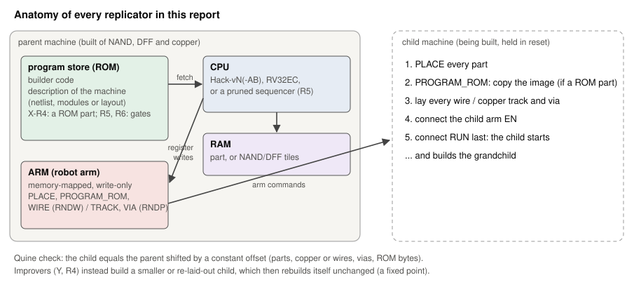

*Figure 1. The common structure. The parent's builder program reads the description from the program store and drives the arm, which builds the child in a fixed order and connects `run` last.*

---

## 3. The two worlds

### 3.1 RNDW: Robot, NAND, DFF, Wires

RNDW (spec `RNDW_SPEC.md`, v0.5) is a grid world. Its parts are NAND (2 × 2 cells), DFF (2 × 2), ROM (2 × max(a, 8) for a address bits), ARM (2 × 9), and wires. A wire runs from one output pin to one input pin. **Wires cross freely and have no length or area**, so routing costs nothing. Time advances in ticks:

1. every enabled arm performs one register write;
2. every DFF latches;
3. the combinational logic settles.

Unconnected inputs read 0. A NAND with both inputs unconnected outputs 1, which serves as a "tie-high" constant. A ROM can only be programmed while no wire touches it. Mistakes such as placing a part on top of another or driving an input twice are counted as **faults** and otherwise ignored. Circuits cannot see faults, but the tests demand zero.

The simulator, `rndw`, is written in Rust using only the standard library. A differential test against an independent Python gate simulator (`nandgen.Sim`) replays seven designs: the ALU, parallel and serial Hack CPUs at three optimisation levels, a RAM, and a CPU with RAM. It compares every output and DFF every tick: **0 mismatches over about 2.9 million comparisons**. A deliberately corrupted gate produced thousands of mismatches, which shows the test can fail.

### 3.2 RNDP: Robot, NAND, DFF, PCB

RNDW gives routing away. RNDP (spec `RNDP_SPEC.md`, v0.4) exists to **price routing**. A wire is no longer an abstract edge; it is copper on a grid, as on a printed circuit board.

* **Two copper layers.** The code allows 1–8, but every replicator was built with exactly 2.
* **Tracks are straight horizontal or vertical runs.** Copper in the same cell on the same layer is connected; copper in neighbouring cells is not. A turn is two tracks sharing a corner cell.
* **To cross without connecting, use the other layer.** A **via** joins the layers at one cell.
* **Pads are through-hole.** A part's pin is copper on every layer, so any track reaching that cell connects to it.
* **Copper is permanent**, so nets only ever merge. The one error the world can detect is a merge that would give a net **two drivers** (two outputs). That command is refused and counted as a fault. Every other wrong connection is simply a wrong circuit, as on a real board.
* **ROM and RAM parts are optional** and can be switched off from the command line. Both are byte-wide; a RAM part of a address bits is 2 × (a + 9) cells.

The world may *check* a layout but never *find* one. Any routing intelligence has to live in the replicator's own program or data, where it shows up honestly in the ROM image.

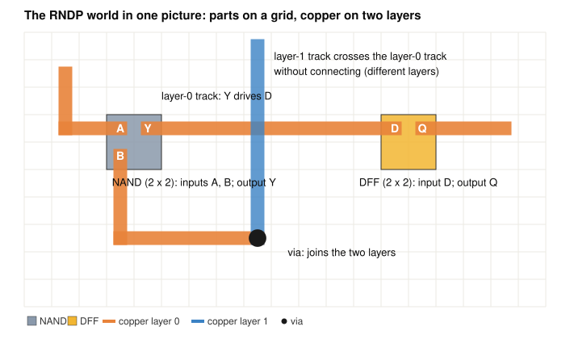

*Figure 2. RNDP in miniature (drawn for this report). A NAND drives a DFF through a layer-0 (orange) track. A layer-1 (blue) track crosses it without connecting, then drops through a via (black dot) back to layer 0 to reach the NAND's B input. The same colours are used in every board picture in this report.*

The RNDP simulator, `rndp`, is again Rust with no dependencies. Connectivity is kept in a union-find structure that is updated incrementally, because copper is never removed. Its own differential test lays the same seven RNDW netlists out as copper and compares them with the Python reference: 0 mismatches over about 2.9 million comparisons. It can dump a restart file whenever an arm's EN pad gets connected, write numbered snapshots, log every executed arm command, and dump every pin's net for connectivity checks. Speed depends on the board: about 33,000 ticks/s for R1, 55–60,000 for R4, and about 470 ticks/s for R6, whose huge gate-built ROM re-settles thousands of gates every time the address changes.

---

## 4. The common recipe and how each machine was checked

### 4.1 Building one replicator

Each replicator went through the same pipeline:

1. **A readable hardware description.** For example, `core_r7.hd` for the Hack machines and `cpu_mod.hd` for R4. Library modules (not, and, or, xor, mux, half adder, full adder, RAM word tile) are instantiated by a body.
2. **A reference flattener in Python** that turns the description into the exact list of arm commands a correct builder must issue. This is the specification.
3. **An encoder** that packs the description into ROM data, with an independent decoder to check it.
4. **The builder in assembly** (Hack or RV32EC), with every line commented. For Y, R1–R4 and R6 a script, `trace_check.py`, confirms that **every byte of the ROM image comes from exactly one commented source line**. That was a standing requirement: nothing in the machine is an unexplained blob.
5. **A seed world**: the first parent, built directly from the reference commands with everything except `run`. It is given 40 warm-up ticks in reset before `run` is connected; without the warm-up the CPU never starts.

### 4.2 The verification ladder

Each rung checks something the previous one cannot.

* **(a) Builder equals reference.** The assembled program runs on a behavioural model of the CPU, and every arm command it issues is compared with the reference list.
* **(b) Geometry equals netlist.** The reference commands are built in the simulator, and every pin's net is compared with the netlist: no opens (missing connections), no shorts (extra ones). The checkers were themselves tested by deleting a command and confirming they noticed.
* **(c) The quine run.** The seed runs at gate level in the simulator until the child is built. A script, `compare_gen.py`, then checks that the child equals the parent shifted by a constant offset: the same parts, the same copper segments (collinear pieces merged), the same vias and the same ROM bytes.

Where (c) was too slow (R4's improver, R5, R6), extra rungs were added instead: a fast Rust emulator, a separate gate-level CPU simulator, partial tick runs, and full connectivity checks. Section by section, this report says which rungs each machine reached.

---

## 5. X: the RNDW quine

### 5.1 What it is

X was the project's first working replicator, finished on 13 October 2026. It is a Hack-vN machine (address bus 13 bits) with:

* a 4 KiB ROM part;
* 32 bytes of RAM built from gates (256 DFFs);
* a CPU core of about 770 NAND and 52 DFF, including address decode and the read multiplexer;
* the arm.

In total it places **2,550 NAND and 308 DFF**, plus one ROM and one arm, connected by 5,311 wires.

The 3,962-byte ROM image holds:

| part | bytes |
|---|---|
| code and return table | 2,226 |
| description stream (the CPU netlist) | 1,724 |
| output table | 12 |

### 5.2 How it describes itself

The key design lesson came before any code was written. Stored as a plain list of gates, the description of a machine with 64 bytes of RAM would be about 14 KB, more than the whole 4 KiB ROM. RAM is regular (eight identical bits per word, identical words), so **only the irregular CPU is stored as data; the RAM is generated by loops**.

* **The CPU netlist.** Each gate's inputs are given as backward distances to the gate that drives them, coded with Exp-Golomb codes (short codes for nearby gates), with escape codes for the ROM data bits, forward references and the like. The core's 1,658 bytes are close to the measured entropy bound of 1,165 bytes.
* **The RAM.** One 60-node word tile (a DFF plus write gating and a read chain for each of 8 bits) is described in 15 bytes and replayed once per word. Read data flows through an OR chain from word to word, so every tile is wired identically.
* **The builder** is a *tile engine* that walks the node list twice: first placing every node, then wiring every node to its drivers. It copies the ROM with PROGRAM_ROM before any ROM wire, wires EN second-to-last, and wires `run` last.

The layout is a single row: node *i* sits at arm + (6 + 2*i*, 9), and the child's arm is 22 cells below the parent's.

### 5.3 Results and checks

* **RAM.** The program uses 30 of its 32 bytes. This was measured with RAM pre-filled with 1s, because a freshly built RAM powers up as all 1s while half-wired gates read 1.
* **Time.** About **7.65 million ticks per generation**: 137 seconds of simulator time.
* **Three generations.** Generation 1 was built by a harness from the reference commands. Its CPU built generation 2, which built generation 3, which had started generation 4 when the run was stopped. Every completed generation has every part and all 5,311 wires at the right arm-relative position, and a ROM byte-identical to the image. **Faults: 0.**

Three facts came out of building X that every later design relied on:

* `run` must feed one gate;
* built RAM powers up as all 1s;
* EN may only be attached after the child's reset state has settled.

### 5.4 The mutation experiment: how fragile is a replicator?

After X worked, the project asked how many of its ROM bits matter. An emulator of the ISA with an arm-command log was validated: 400 random differential tests against the Python model, and exact reproduction of the saved generation-1 → 2 → 3 worlds. It was then used to run *mutants*: copies of X's ROM image with bits changed.

**Byte audit.** Of X's 4,096 ROM bytes, 2,128 are executed as instructions, 1,834 are read as data, and 134 are never touched. Trying all 255 other values on the 174 bytes that are never interpreted (134 unread plus 40 that are only copied) showed that all 174 are truly free: changing them does not affect replication. 300 random joint changes of all 174 gave 300 working children.

**Every single-bit flip (32,768 flips).**

| outcome | flips |
|---|---|
| builds the same machine, child carries the mutation (a new fixed point) | 5,612 |
| builds the same machine, mutation not copied (child reverts) | 1,072 |
| builds the same machine, child ROM differs again (not yet a fixed point) | 200 |
| crashes or never halts | 4,825 |
| builds a *different* machine | 21,059 |

Most of the "fixed point" flips in executed bytes are bits the ISA model ignores, such as unused instruction bits. That is a fact about the model, not checked in hardware.

**Do the different machines replicate?** A random sample of 100 of the 21,059 "different machine" mutants was run in a modified copy of the RNDW simulator. The modification only adds a command log; the world rules were unchanged, and it reproduced a saved generation byte for byte. Each mutant's child was built and then run at gate level to see whether it builds an exact copy of itself.

| outcome (100 sampled mutants) | count |
|---|---|
| **child replicates exactly** | **4** (95 % confidence interval 1.6–9.8 %) |
| child built but never issues a command | 50 |
| child's first command is wrong | 30 |
| parent never finishes building | 11 |
| parent programs the child's ROM wrongly | 3 |
| parent leaves the child's EN unwired | 2 |

The four survivors are worth a closer look. Each flips one bit in the description stream, which **redirects one wire of the CPU** to a different gate. The changed signals differ from the original on 30–85 % of ticks during a normal generation, yet the CPU still copies itself exactly, because the affected logic is never observable for the instructions the quine executes. They are replicators *for this program*, not necessarily correct CPUs. No mutant in the executed code (34 sampled) replicated.

Two more observations. The arm has no remove command, so a bad parent cannot damage itself; it can only fail to build a working child. And a fair share of X's hardware evidently does nothing for the quine's own instruction stream.

---

## 6. Y: the self-improving CPU in RNDW

### 6.1 What it is

Y asks for more than copying: **the child should be better than the parent**, with "better" meaning fewer NAND gates. Y's 16 KiB ROM (address bus 15 bits, the maximum Hack's 15-bit constant allows) holds three things:

* **A readable hardware description (HD)** of 3,326 bytes. Library modules (not, and, or, xor, mux, half adder, full adder, RAM word tile) are instantiated by a body, and a chain section generates the 256 RAM word tiles by loops.
* **A builder** of 4,970 bytes, which reads the HD and builds the machine through the arm.
* **An improver** of 7,958 bytes, which runs inside the world, on the machine's own CPU.

The seed machine g1 uses the textbook gate implementations. It places **15,495 NAND and 2,104 DFF**; 2,048 of those DFFs are the 256-byte RAM. The ROM image is 16,350 of 16,384 bytes. **The ROM is full**: there are 34 free bytes.

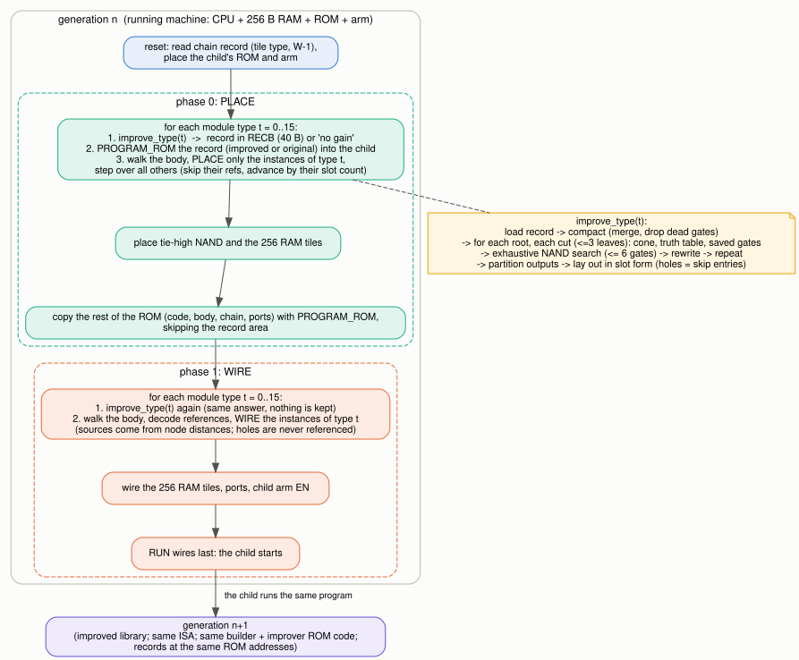

*Figure 3 (from the Y write-up). The builder walks the HD once per module type. Before each group it calls the improver on that type and builds the child from the improved record.*

### 6.2 How the improver works

For each library module, the improver does the following:

1. **Compacts the module**, merging identical gates and dropping dead ones.
2. **Finds small cuts.** For each output it enumerates sub-circuits with at most 3 inputs ("cuts") and computes their truth tables.
3. **Searches exhaustively** for the smallest NAND circuit with that truth table (iterative deepening, up to 6 new gates).
4. **Rewrites the module** if the search found something strictly better.
5. **Writes the improved record** back in "slot form", so it fits in the old record's space, into a 40-byte RAM buffer.

The builder then reads that buffer exactly as it would read ROM, builds the child from it, and programs it into the child's ROM in place of the old record.

| module | gates in g1 | gates in g2 |
|---|---:|---:|
| not / and / or | 1 / 2 / 3 | unchanged |
| xor | 9 | **4** |
| mux | 8 | **4** |
| half adder | 11 | **5** |
| full adder | 25 | **9** |

None of the improved gate lists are stored in the ROM; an audit confirmed that the answers are computed. The improver is also general: on modules that are *not* in the seed library it finds xnor 10 → 5 and majority 12 → 6, and it leaves and3 at 4 (already minimal).

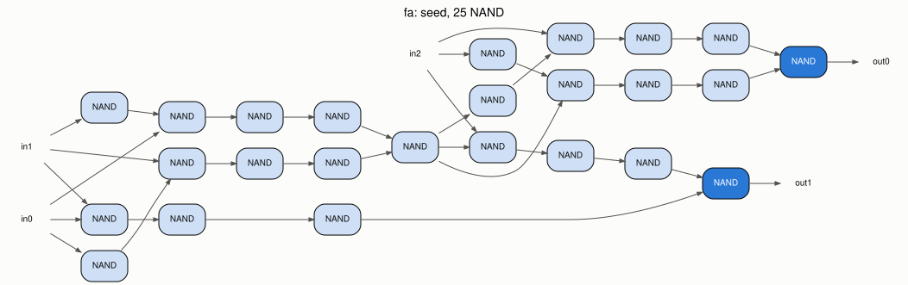 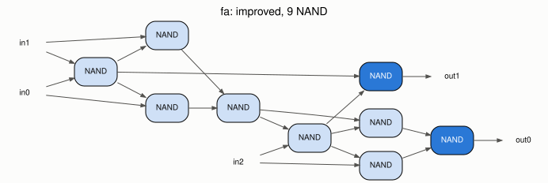

*Figure 4 (from the Y write-up). The full adder before (25 NAND, textbook) and after (9 NAND, found by the improver running inside the world).*

### 6.3 Results and checks

* **Gates.** g2 places **14,549 NAND and 2,104 DFF**: 946 fewer NAND (−6.1 %), and −29 % of the logic outside the RAM array.
* **Fixed point.** g3 equals g2. The improver runs again in g2 but finds nothing more within its search.
* **The run.** The three-generation run took 200,196,267 ticks (about 7 hours of simulator time) with **0 faults**. Every part, wire and ROM byte of each generation matches the Python reference.
* **RAM.** The high-water mark is 196 of 256 bytes. Builder and improver temporaries share addresses; only a 29-byte block and the 40-byte record buffer survive between calls.
* **Time per generation.** About 82 M ticks (g1 → g2) and 66 M (g2 → g3). These are **estimates** (instruction count × 2.6 ticks per instruction), not measurements.
* **Mutation testing.** Single-bit changes in 60 executed instruction words of builder and improver: all 60 caught by the tests.

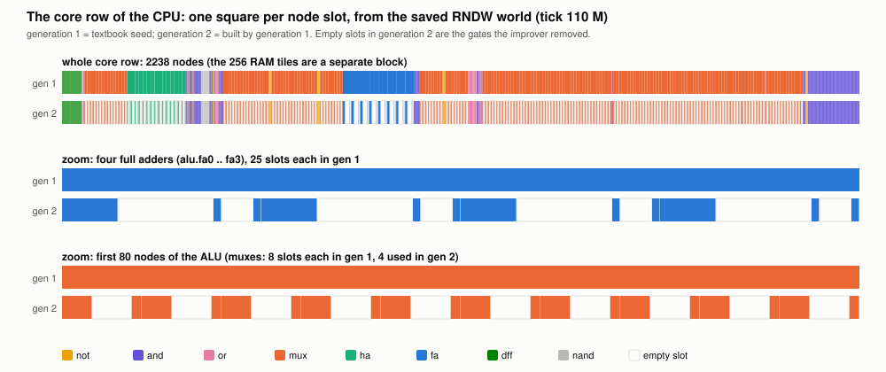

*Figure 5 (from the Y write-up). Y's core row, one square per node slot, in g1 and g2. The improved records keep their slot positions, so the gates the improver removed show up as empty slots in g2 (here in the full adders and the muxes).*

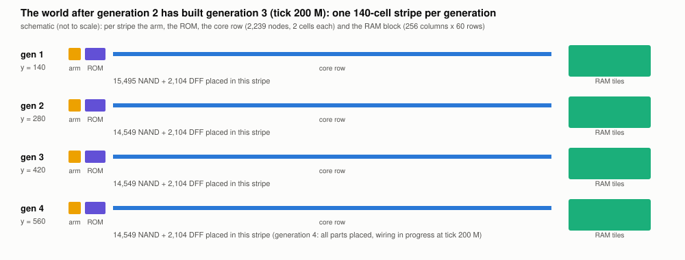

*Figure 6 (from the Y write-up). The RNDW world at tick 200 M. Each generation lives in its own horizontal stripe; g1–g3 are complete, and g4 is placed and about two-thirds wired.*

### 6.4 What Y is not

The project's own write-up states the limits plainly:

* **Only combinational library modules are improved.** The DFFs, the RAM array, the arm and the improver's own code are never changed. The claim is "improves its gate-level logic", not "improves itself".
* **The seed contains the redundancy that the improver removes.** A seed that is already optimal would improve nothing.
* **The ROM costs more than the improvement saves.** If ROM bits are charged even lightly, the 8 KB of improver code costs more than the 946 NAND it saves. Y is an *existence* proof of a self-improving replicator, not a cost-effective one.

---

## 7. R1 and R2: moving to a printed circuit board

### 7.1 R1: the loose baseline

R1 takes Y's Hack-vN-AB machine without the improver and rebuilds it in RNDP. It has 16 KiB of ROM and 128 bytes of RAM made of 128 gate tiles, each 52 NAND + 8 DFF. Altogether that is **8,809 NAND and 1,080 DFF** (1,024 of the DFFs are RAM).

The layout is the simplest one that is guaranteed to work, a **dedicated-lane layout**:

* every core node sits on its own diagonal position, at x = 10 + 2*g*, y = 13 + 3*g*;
* every input pin gets its own horizontal lane;
* each connection is a vertical track on layer 1 from the driver to the lane, a via, then a horizontal track on layer 0 to the pin.

No two connections can collide, so the builder computes every coordinate from the node number. **The ROM holds no copper data at all.** The cost is area: **4,581 × 29,698 cells (136 million)** for 9,889 gates, about 13,800 cells per gate.

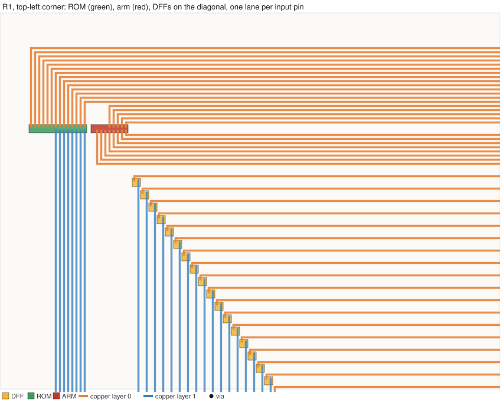

*Figure 7. R1's top-left corner (drawn for this report). The ROM part (green, rotated) and the arm (red) have their buses fanned out on layer 0. DFFs step down a diagonal, and each input pin has its own horizontal lane.*

The ROM has 7,459 nonzero bytes: 4,549 of builder code and 2,910 of hardware description. The 128 RAM tiles take only 97 bytes of rules. The builder executes 19.4 M instructions and uses 118 of its 128 RAM bytes.

**Check.**

* The reference geometry has 9,899 nets, all equal to the netlist, with 0 refused commands. Dropping one command is detected.
* The assembly builder issues exactly the reference commands.
* In the quine run, at tick 50 M the child (4,700 cells to the right) has the same 9,891 parts, 47,369 segments, 18,731 vias and 7,459 programmed ROM bytes as the parent, and has started a grandchild. The child's EN wire went down at tick 49,529,755: **about 49.5 M ticks per generation**.

### 7.2 R2: the free RAM part

R2 replaces the 128 RAM tiles with one RAM part. The 63 RAM-select gates of the core go too, because the part decodes its own address. What remains is **2,034 NAND and 56 DFF**.

| | R1 | R2 |
|---|---|---|
| NAND / DFF | 8,809 / 1,080 | 2,034 / 56 |
| RAM | 128 gate tiles | 1 part, 1,024 bits |
| segments / vias | 47,369 / 18,731 | 10,454 / 4,173 |
| total track length (cells) | 29.0 M | 4.30 M |
| bounding box | 4,581 × 29,698 = 136.0 M | 4,222 × 6,318 = 26.7 M |
| ROM bytes programmed | 7,459 | 6,119 |
| builder instructions | 19.4 M | 5.2 M |
| ticks per generation | 49.5 M | 13.2 M |

The free RAM part removes 79 % of the gates and 81 % of the area, but only **18 % of the ROM image**. The tiles were already cheap to describe, because a loop generates them; the description and the builder are dominated by the irregular core. R2's quine run: the child's EN wire went down at tick 13,229,153, and at tick 14 M the child had the same 2,093 parts, 10,454 segments, 4,173 vias and 6,119 ROM bytes, with **0 faults**.

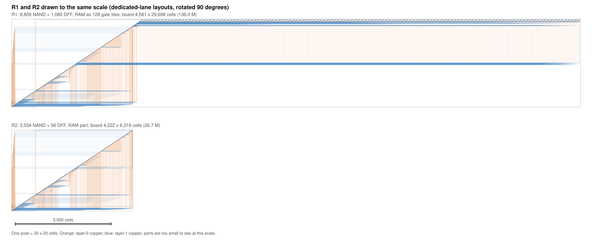

*Figure 8. R1 and R2 at the same scale (drawn for this report; rotated 90°). Almost all of R1's area is the long run of RAM tiles and their lanes.*

---

## 8. R3: the RV32EC quine

R3 asks whether a standard ISA helps. Its CPU is a **byte-serial, microcoded RV32EC**:

* an 8-bit ALU;
* a 128-entry microprogram (83 micro-instructions) implemented as a PLA;
* registers x1–x15 kept in RAM rather than in flip-flops;
* a 776-gate expander for the compressed 16-bit instructions, verified over all 28,822 halfwords.

It takes about 55 ticks per instruction and uses only **2,922 NAND and 77 DFF**. Memory is a 16 KiB ROM part and a 256-byte RAM part.

The builder is hand-written RV32EC of **806 bytes**, against the 3,557 nonzero bytes of R2's Hack builder. The netlist data is 7,176 bytes, so the image is 7,982 bytes. Code density is what RV32EC brings: the builder is about a quarter of R2's. But R3's netlist data is much larger (7,176 bytes against R2's 2,562 nonzero bytes of description), because the CPU has more gates and is stored as flat node records rather than as instances of library modules, so the whole image ends up about 30 % larger than R2's 6,119 nonzero bytes.

The CPU went through more independent checks than any other part of the project:

* the assembler cross-checked against `llvm-mc` (4,800 cases);
* the emulator against code compiled with `clang`;
* RTL against the emulator in lockstep;
* the gate-level netlist against RTL tick for tick.

**Check.** QUINE PASS: parts, segments, vias and ROM contents identical, 0 faults. A generation takes **about 11.05 M ticks**, and **5 copies existed after 40 M ticks**: the children keep replicating. The board is 6,040 × 9,046 cells (dedicated lanes again).

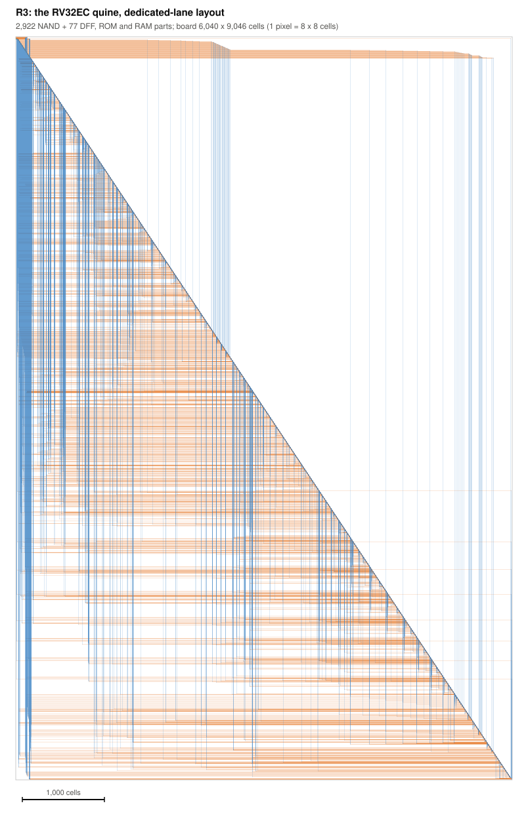

*Figure 9. The whole R3 board (drawn for this report; 1 pixel = 8 × 8 cells). The diagonal is the gate row; each gate input has its own lane.*

---

## 9. Compact layouts: R2c and R3c

### 9.1 Trading ROM for area

The loose layouts waste nearly all their board. R2c and R3c are the same machines as R2 and R3, laid out **compactly**:

* NAND and DFF sites on a regular grid (pitch 5 for R2c, pitch 6 for R3c);
* placement by simulated annealing on total wire length;
* routing by a **PathFinder-style negotiated-congestion router**, a classic FPGA routing algorithm in which nets that fight over cells raise those cells' cost until they settle.

This is done offline, by the project's Rust tool `rndp_layout`, not inside the world. The result is then **stored in the ROM** for the builder to replay.

The encoding:

* Sites are numbered on the grid, so placement is implicit (a bitmap of part kinds).
* Each sink pin gets one routed path from the pin back to any cell of its net's existing copper. A path is a list of segment bytes: last-flag, via-flag, direction and length 1–15.
* EN and RUN come last.

Because a path may end on *any* existing copper of its net, the order of paths does not matter electrically. That is what makes replaying them safe.

| | R2 (loose) | **R2c** (pitch 5) | R3 (loose) | **R3c** (pitch 6) |
|---|---|---|---|---|
| NAND / DFF | 2,034 / 56 | 2,034 / 56 | 2,922 / 77 | 2,938 / 78 |
| ROM image | 16,041 B (6,119 nonzero) | 13,050 B (code 2,178 + layout 10,872) | 7,982 B | 21,470 B (code 598 + layout 20,872) |
| ROM part used | 16 KiB | 16 KiB | 16 KiB | 32 KiB (needed: data > 16 KiB) |
| bounding box | 26.7 M cells | **62,160 cells (240 × 259)** | 54.6 M cells | **121,410 cells (342 × 355)** |
| segments / vias | 10,449 / 4,171 | 9,864 / 2,120 | 14,956 / 5,970 | 18,272 / 5,293 |
| total track length | 4.3 M | 49,735 | 9.97 M | 110,868 |
| builder instructions | 5.2 M | 3.47 M | | 727,585 |
| ticks to the child's EN wire | 13.2 M | ~8.9 M | ~11 M | ~19.9 M |

The trade is clear:

* **Area.** About **400× less**: R2c's whole board is smaller than one corner of R2's.
* **ROM.** About **2.7× more for R3c**. For R2c the image is still well under 16 KiB, because R2's loose image already contained a netlist that the layout replaces.

The routed layout costs about **41.6 bits per gate** in R2c. A finer pitch does not route: pitch 4 failed for R2c and pitch 5 for R3c. Going from pitch 7 to pitch 6 cost R3c 1.3 KB more data for 24 % less area.

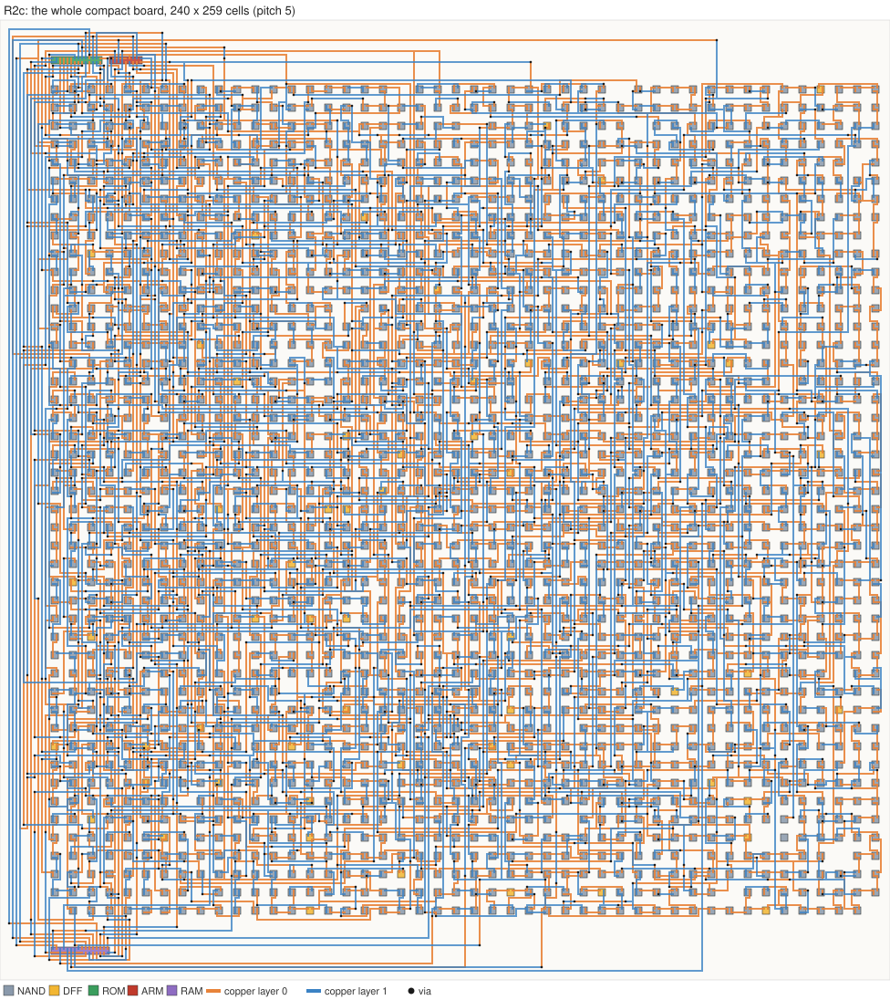

*Figure 10. The whole R2c board, 2,034 NAND + 56 DFF on 240 × 259 cells (drawn for this report). Every track and via here was placed by the machine's own arm from data in its ROM.*

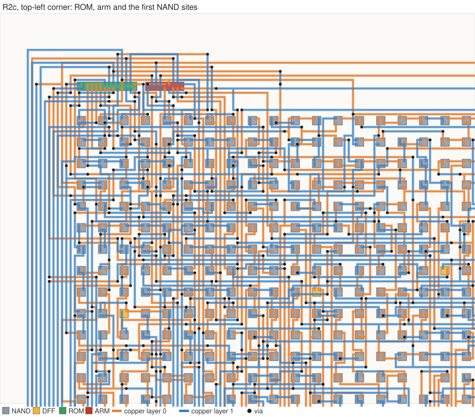

*Figure 11. R2c's top-left corner, enlarged: the rotated ROM part (green) and arm (red), NAND sites on the 5-cell grid, and routed copper on both layers.*

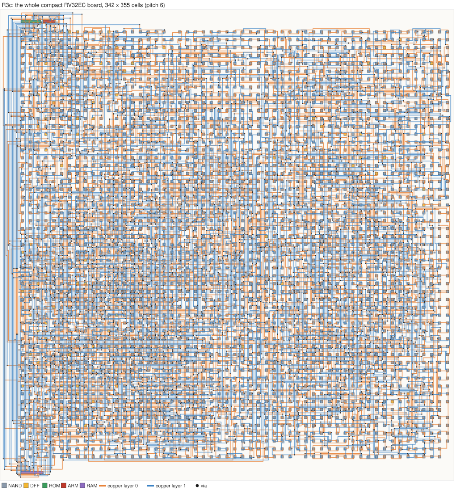

*Figure 12. The whole R3c board, 2,938 NAND + 78 DFF on 342 × 355 cells (drawn for this report).*

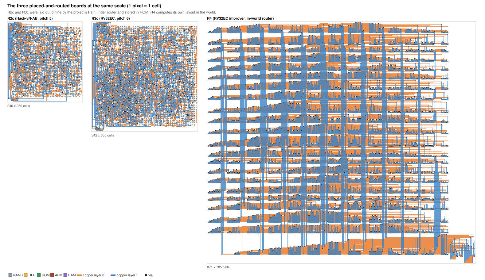

*Figure 13. R2c, R3c and R4 at the same scale, one pixel per cell (drawn for this report). R4's layout comes from its own in-world placer and router, which is simpler than the offline router and leaves channels between gate rows.*

### 9.2 Checks

Both passed the full ladder.

* **R2c.**
  * The builder on the instruction model, an independent ROM decoder and the layout copper all agree.
  * Built in rndp: 2,108 nets equal to the netlist, 0 problems.
  * Full quine in rndp over 15 M+ ticks: **QUINE PASS**, with 2,093 parts, 9,867 segments, 2,120 vias and 12,435 ROM bytes identical, 0 faults.
* **R3c.**
  * Built: 3,034 nets, 0 problems.
  * Full quine over 45 M ticks at both pitch 6 and pitch 7: QUINE PASS, with 20,468 ROM bytes identical, 0 faults.
  * The existing CPU tests (lockstep, gate versus RTL, clang cross-check) pass with the 15-bit ROM address.

### 9.3 Re-run for this report

To see a compact replicator working, the R2c quine was run again for this report. The seed was rebuilt from the repository's stored layout (`rndp_layout/data/r2c_p5.lay`), netlist and ROM image, and run in `rndp` for 20 million ticks with a snapshot every 2.5 million. The run took 490 seconds and ended with **0 faults**.

* **Child.** `compare_gen.py` on the final state reports **QUINE PASS**: the child has the same 2,093 parts, 9,867 copper segments, 2,120 vias and 12,435 ROM bytes as the parent, with 0 differences.
* **Grandchild.** It was also complete by tick 20 M, and its parts, segments and vias equal the child's shifted by 262 cells (checked with a short script written for this report).
* **Great-grandchild.** By tick 20 M all its parts were placed and its ROM was being programmed.

The snapshots give a generation time of a little under 9 M ticks, consistent with the recorded first EN at about 8.87 M.

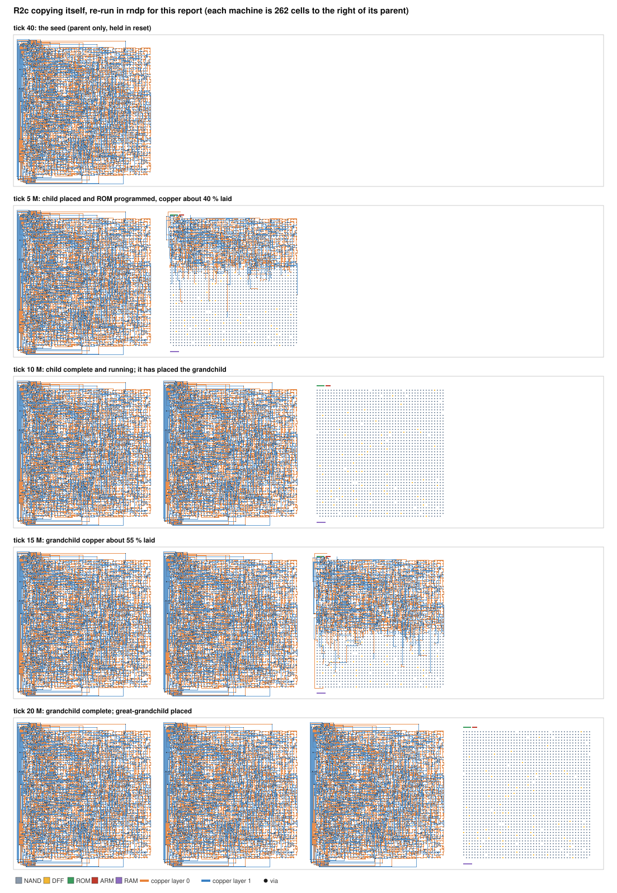

*Figure 14. R2c building its child, from a fresh rndp run of the repository's files (drawn for this report). The parent is on the left; the child is 262 cells to the right.*

---

## 10. R4: the RV32EC improver that places and routes itself

### 10.1 What it does

R4 is the most capable machine in the project. Starting from a **semi-abstract hardware description** in its ROM, it does all of the following inside the world:

1. **Flattens** the description into a gate list.
2. **Improves** each library module, with the same algorithm as Y ported to RV32EC assembly.
3. **Writes** the improved description for the child.
4. **Flattens** again.
5. **Builds a connectivity graph** and computes a **placement order** by multilevel label propagation and greedy chaining.
6. **Folds** the gate row into a serpentine of rows.
7. **Routes every net** with a row-and-channel router using left-edge track assignment.
8. **Emits** the arm commands, including PROGRAM_ROM of the program with the improved description.

The child is therefore built from a layout the machine computed itself, not from stored copper.

* **Seed.** The CPU is the same byte-serial RV32EC as R3, regenerated from a *textbook module library* (one module instance per datapath operation, nothing shared), so that there is something to improve. The microcode PLA and the instruction expander are kept as fixed flat tiles.
* **Memory map.** The final map has a 64 KiB ROM part and a **256 KiB RAM part**. The RAM size was chosen because the placer and router need room for per-net tables.

| | seed (g0) | improved (g1 = child) |
|---|---|---|
| NAND (including one tie-high node) | 4,719 | **3,770** |
| DFF | 81 | 81 |
| xor / mux / half adder / full adder | 9 / 8 / 11 / 25 | 4 / 4 / 5 / 9 |

The improver saves **949 NAND (−20.1 %)**. That is a much larger share than in Y, because R4's CPU has no gate-built RAM array to dilute it. An earlier README in the tree quotes 4,612 → 3,690. That was the same improvement on the older 8-bit RAM map; the wider 18-bit address bus adds about 80 gates.

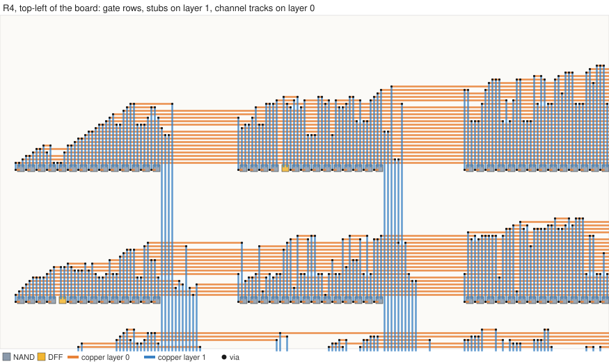

*Figure 15. Part of R4's self-made layout (drawn for this report). Each row of gates sends one layer-1 stub per pin up into a channel, where nets run along layer-0 tracks assigned by the left-edge algorithm.*

### 10.2 The program and how it was built up

The program is **28,167 bytes of hand-written RV32EC** across 16 source files, every byte traced to a source line. It was built and checked kernel by kernel against Python references that were made bit-exact first: integer-only arithmetic, fixed tie-breaks, and a specified random-number generator.

| stage | instructions (emulator) |
|---|---|
| improver, 7 library modules | ~1.4 M |
| graph + placement order | 18.3–19.3 M |
| routing (three kernels) | 10.7 M |
| **whole program, seed description** | **33,414,247** |
| whole program, improved description (fixed point) | 32,287,077 |

The improver is cheap; placement and routing dominate. Each kernel was compared bit-for-bit with its reference on random and real inputs. The improver kernel matched the reference on 351 test modules with 0 mismatches, and a mutation test of its rules caught 9 of 9 listed mutants. One rule change (search depth 6 → 5) could not be distinguished on any module tried, which is stated as a coverage gap.

### 10.3 Checks: from emulator to gates to the world

* **S5: emulator.** The whole program on a dependency-free Rust RV32EC emulator issues **69,683 arm commands** (3,854 place, 24,947 ROM bytes, 40,882 track/via), identical to the Python reference command for command. Run with the improved description, it rebuilds a ROM image equal to its own: the fixed point.
* **S6: structural replay.** The commands built in rndp give 3,770 NAND, 81 DFF, 3,869 nets, 24,174 segments and 16,708 vias. Every one of the 11,472 gate pins is on the right net: **0 shorts, 0 opens**.
* **S7: gate-level CPU.** A separate Rust gate simulator ran the 3,770-NAND netlist from reset through the whole program: 987 M ticks, 65 minutes. All **552,115 arm-register writes were identical** to the emulator's, and the final RAM was identical except for 8 bytes where the gate CPU keeps its PC. That is 29.55 ticks per instruction on average.
* **S8: the real run in rndp.** The parent machine, the improved fixed point placed on an 871 × 785-cell board, ran in rndp from reset with a 1.1 G-tick budget. One container restart was survived by resuming from a checkpoint.
  * First arm command at tick 774,326,003, last at tick 958,654,234: **69,718 commands, 0 faults**.
  * The child, 880 cells to the right, had **3,854 parts, 24,174 segments, 16,708 vias and 24,982 ROM bytes identical** to the parent: **QUINE PASS**.
  * After the 5 `run` wires the child started; it was run for 16 M more ticks with no faults.
  * The run took about 4.8 hours at 55–60 k ticks/s.

**Limits (from the S8 report).** Only one generation was run; the grandchild would need another ~960 M ticks. The parent was built from the same command stream the child is compared with, so the run shows that the in-world CPU reproduces that stream, while the separate connectivity check (S6) shows the stream is a correct circuit. Only one placement seed and one netlist were tried.

R4 is big because of its RAM part: 256 KiB is 2 million bits. With the RAM counted as gates at about 12 NAND-equivalents per bit, it would be about 26 M gates, so **memory is over 99 %** of a gate-built R4. R4 proves that an in-world designer of this kind *can* be built. It is not small.

---

## 11. R5: the program as gates, the machine pruned

### 11.1 The question

Every machine so far uses at least a ROM part, which is free. R5 and R6 switch **both ROM and RAM parts off** (`rndp --rom off --ram off`): everything, including the program, must be NAND and DFF. R5 was allowed to drop Turing completeness and use whatever architecture minimises gates.

Small experiments came first:

* **E1: ROM as gates.** A gate-built ROM costs about **2.2–2.4 NAND per stored 1-bit** (0-bits are free) and can be laid out by a formula derived from its own contents.
* **E2: RAM as gates.** Addressable RAM costs about 6.3 NAND + 1 DFF per bit. A recirculating shift register is cheaper only above about 64 bits.
* **E3: ISA re-ranking.** With these prices, describing each irregular gate to itself (26–55 bits per gate) dominates every candidate.

The conclusion: minimise irregular logic, maximise regular structure, and prefer encodings with few 1-bits.

### 11.2 What was built

* **The plane.** R5 stores its program as a **token-ring plane**: one row per stored word (10,975 rows), each row a DFF in a ring that passes a single "token" from row to row, a row inverter, and an INV + NAND pair for every 1-bit in the row's 24 columns. Reading the plane means circulating the token; the active row drives the column lines.
* **The engine.** A small engine of **981 NAND + 77 DFF**, laid out at pitch 9 by the project's router, interprets the rows in two passes:
  1. it decodes a compressed layout stream to build its own engine;
  2. it walks the plane again to emit the plane itself, one cell per 1-bit, plus explicit commands for the arm and the long wires.
* **The copy.** The plane is copied by reading it: the child's plane is built from what the parent's plane says. The child sits 900 cells away.
* **E5: encoding weight.** Inverting two dense columns (a command flag set in 96 % of layout words and a track-code bit) saved 15,288 stored 1-bits, **−15.4 %** in the combined count.

| | E4 (first build) | **E5 (final)** |
|---|---|---|
| NAND | 165,967 | **132,214** |
| DFF | 11,427 | **11,052** |
| plane rows (W) | 11,350 | 10,975 |
| stored 1-bits | 76,818 | 60,130 |
| arm commands to build a child | 833,215 | 720,806 |
| engine cycles per generation (model) | 515 M | 482 M |
| bounding box | 429 × 45,760 | 429 × 44,260 |

Where the gates go in the final build:

* plane 1-bits: 2 NAND each, about 120 k;
* row DFFs: one per row, about 11 k;
* row inverters: about 11 k;
* engine: about 1 k.

The **layout description** is 81 % of the stored 1-bits. R5 stores 218 bits per described gate, against R2c's 41.6. Its one-word-per-copper-command stream is about 5× less dense than R2c's path code.

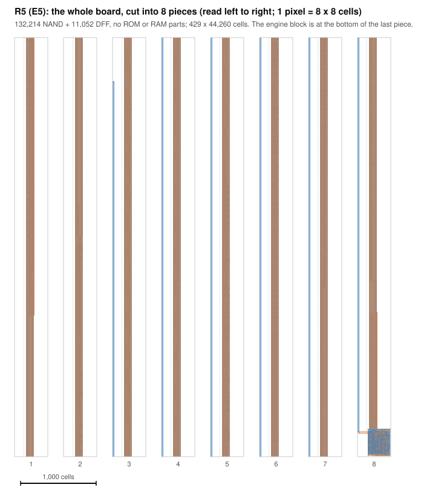

*Figure 16. The whole R5 board, cut into eight pieces so that it fits on a page (drawn for this report). It is a plane 96 cells wide and 44,000 cells tall. The engine block is at the end of the last piece.*

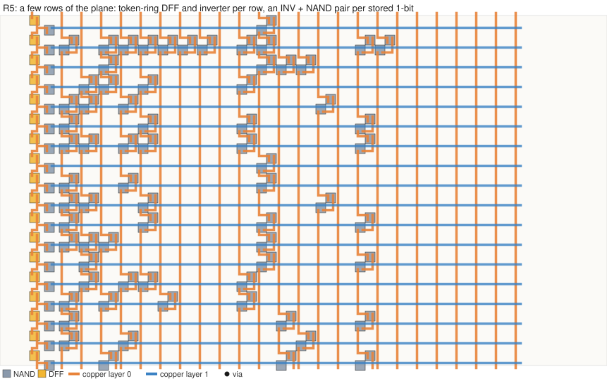

*Figure 17. A few rows of R5's plane (drawn for this report). Each row has a token-ring DFF (yellow) and inverter at the left; each stored 1-bit is an inverter + NAND pair on the row line.*

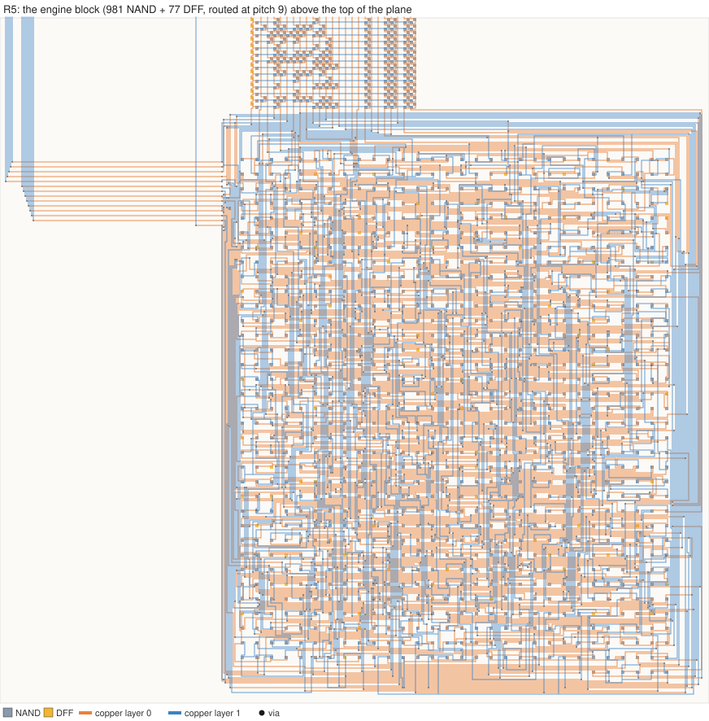

*Figure 18. R5's engine: 981 NAND + 77 DFF placed and routed at pitch 9, the only irregular logic in the machine (drawn for this report). The top of the plane is visible above it.*

### 11.3 Checks

* **Build.** `rndp --build` of the parent world: 0 refused commands, 0 faults. A pad dump shows all 418,759 pins on their logical nets, with 0 missing, 0 opens and 0 shorts.
* **Model.** A Rust model of the engine, equal to a Python model on a small ring, emits 3,780,092 arm writes, and the resulting child equals the parent shifted by 900: 143,267 parts, 1,406 vias, 372,518 merged wire runs.
* **Gate-level engine.** The real routed engine netlist, simulated at gate level at full size, produces all 3,780,092 arm writes identical to the model.
* **Not done.** A tick-level rndp run of the whole world (about 5 × 10⁸ ticks on 143 k parts). The gate-level run models the plane abstractly; its physical wiring is checked by the pad dump instead.

**Reading.** R5 did not beat the earlier machines. Pruning the control logic to about 1 k gates worked, but the cost moved into *describing the layout*, which for a gate-built program store is paid in gates. The experiment located the dominant term precisely.

---

## 12. R6: a Turing-complete machine that builds its own ROM and RAM

### 12.1 Design

R6 keeps the Hack-vN-AB CPU and its 16 KiB program and switches both memory parts off. It is three blocks joined by formula-generated wires (Figure 19).

1. **The core.** R2c's compact core, 2,034 NAND + 56 DFF, re-routed with its ROM and RAM pins moved to the board edge. Its routed paths are stored in ROM, and Huffman-coded to fit.
2. **A ROM plane built from gates.**
   * Address decoders are AND chains of 6 NAND + 6 NOT per line.
   * The plane stores each 1-bit as a small NAND gadget on an OR chain that runs through the whole plane, one chain per output bit; 0-bits are simple pass-through slots.
   * Every wire is a formula of (strip, column, bit), with no router. Nothing in the plane depends on stored layout data, so the builder emits it by scanning its own program bytes.
3. **A RAM block built from gates.** 128 select lines and **128 copies of one word tile** (50 NAND + 8 DFF), routed once offline and replayed by translation, giving 7,952 NAND + 1,024 DFF. A cycle simulation of 1,500 random reads and writes against a Python model had 0 mismatches.

The builder is a Hack program with a small "glue VM" of templates and offsets. It builds the core from stored paths, then the plane, the RAM block and 46 interface wires by loops. All of it has to fit in the program it is copying: the Hack CPU maps ROM at 16384–32767, so the **image cap is 16 KiB**. Getting there needed Huffman coding of the core's path stream (10,188 → 8,165 bytes plus 255 bytes of tables). The final image is **16,006 bytes (378 bytes spare)**. Huffman coding raised the stored 1-bits by about 7 % (≈ +5 k NAND) but was the only way to fit.

The fixed point is reached by iteration: image → plane and board → interface wires → image, until nothing changes. With the stored inputs it settles in one pass. When the R6 build script was re-run for this report from the repository, it reached "FIXED POINT reached after 1 iteration", a 16,006-byte image, and a board of 134,797 NAND + 1,080 DFF with 529,447 copper segments and 99,177 vias. That matches the recorded numbers exactly.

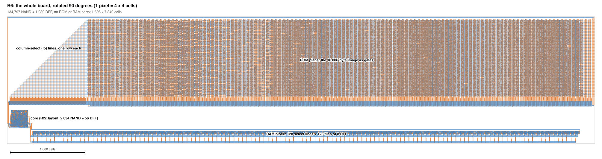

*Figure 19. The whole R6 board, rotated 90° (drawn for this report). The small square is the R2c-style core; above it the column-select wiring fans into the ROM plane, which holds the machine's own 16,006-byte program as gates; the RAM block runs along the bottom.*

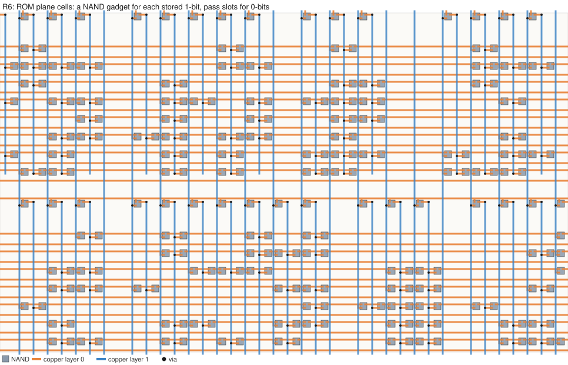

*Figure 20. Inside R6's ROM plane (drawn for this report). Each stored 1-bit is a two-NAND gadget on its bit's chain; empty slots are 0-bits.*

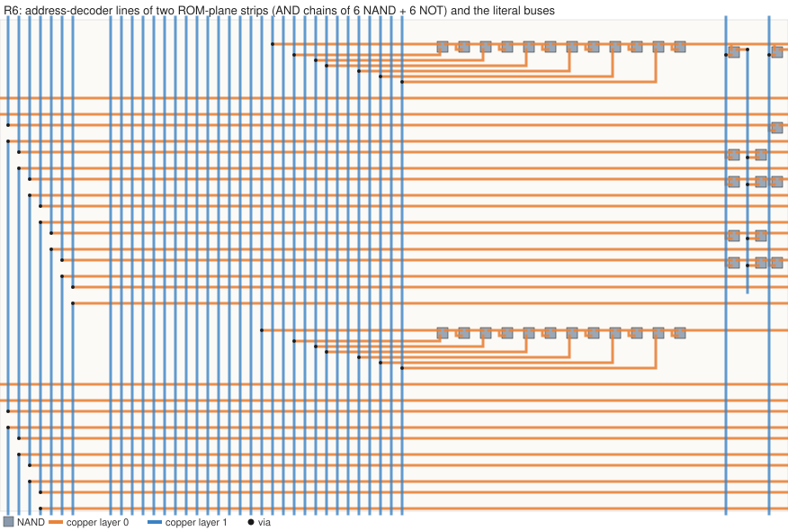

*Figure 21. R6's row-decoder lines: each is an AND chain of 6 NAND + 6 NOT tapping literal buses through vias (drawn for this report).*

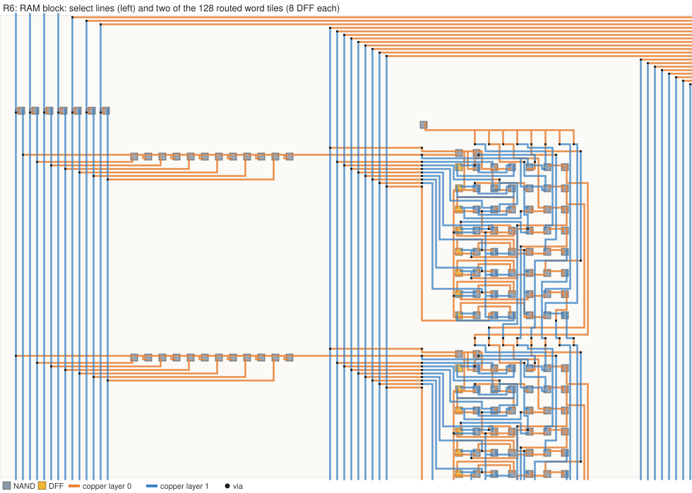

*Figure 22. R6's RAM block: two of the 128 word tiles (8 DFF each, yellow) and their select lines (drawn for this report).*

### 12.2 Results and checks

* **Size.** **134,797 NAND + 1,080 DFF.** Of these, the core is 2,034 + 56, the RAM block 7,952 + 1,024, and the ROM plane with its decoders about 124.8 k NAND. The board is 1,696 × 7,840 cells.
* **Model run.** The Hack builder ran on the instruction model for **754 M instructions** and issued **763,734 arm commands**, all equal to the reference generator. The one difference is that 3,072 RAM-block tracks were emitted as 2,304 longer segments covering identical copper.
* **Whole board in rndp.** 0 refused, 0 faults; **406,564 pins, 0 opens, 0 shorts**.
* **Partial tick run.** The CPU read its program *from the gate-built plane* and kept its variables in the *gate-built RAM block*. Over 1 M ticks it issued its first 452 arm commands with 0 mismatches against the reference.
* **Not done.** A full tick-level run of one generation. That would be about 764 k commands × ~318 ticks per command, i.e. 2.4 × 10⁸ ticks, at ~470 ticks/s: roughly six days of simulator time, judged infeasible when R6 was built. Ticks per generation are therefore unmeasured.

R6 is the project's answer to "can a Turing-complete machine in this world copy itself with no free memory parts?" Yes, at about 135 k NAND and 1 k DFF, built and checked to the level above.

---

## 13. Comparison: what the numbers show

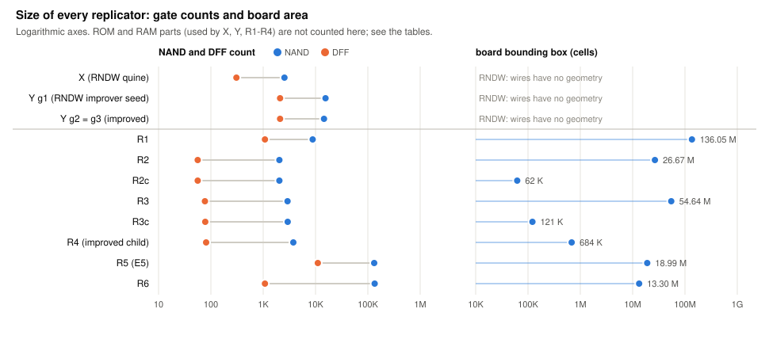

*Figure 23. Gate counts and board areas of all ten machines on logarithmic axes. ROM and RAM parts are not included in the gate counts; Table 1 lists them.*

### 13.1 Comparing like with like

The machines are not all doing the same job, and they do not all get the same free parts:

* X, Y and R1–R4 have a **free ROM part**, and R2–R4 a **free RAM part** too. R5 and R6 have neither.
* Y and R4 **improve**; the rest only copy.
* R5 is **not Turing complete**; the rest are.
* X and Y live in RNDW, where **wiring is free**.

So the fair pairwise comparisons are these.

| comparison | what changes | result (measured) |
|---|---|---|
| X → R1 | wires become copper (and the machine grows: 15-bit bus, 128 B RAM) | image 3,962 B → 7,459 nonzero bytes; a board of 136 M cells appears. Not a pure routing comparison |
| R1 → R2 | RAM part allowed | −77 % NAND, −95 % DFF, −81 % area, but only −18 % ROM |
| R2 → R3 | Hack → RV32EC | builder code 3,557 (nonzero) → 806 bytes; CPU 2,034 → 2,922 NAND |
| R2 → R2c, R3 → R3c | loose → compact layout | ~400× less area; layout data 10.9–20.9 KB |
| R2c → R6 | ROM and RAM parts → gates | 2,034 → 134,797 NAND; 56 → 1,080 DFF |
| R5 vs R6 | pruned sequencer vs Hack, both all-gates | nearly equal NAND (132 k vs 135 k); 11,052 vs 1,080 DFF |

### 13.2 A single number, with care

The project often summarised a machine as **NAND + 6 × DFF**. As a rough guide it is useful; it is not a law, since a DFF can be made of more or fewer gates. On that measure, for the machines with no memory parts:

* **R6: 141,277**, Turing complete.
* **R5: 198,526**, not Turing complete.

The whole difference is DFFs. R5's plane needs one DFF per stored word (about 11 k); R6's ROM plane has no state at all, and its only DFFs are the CPU's 56 and the RAM's 1,024.

The project also tried to put the part-using machines on the same scale by pricing a ROM part as an E1-style gate plane and a RAM part at 12.3 per bit (`rndp_r5/REPLICATOR_COMPARISON.md`). The results were about 48 k for R2, about 56 k for R1, about 71 k for R3, about 99.5 k for R2c, about 170 k for R3c and about 26 M for R4. Those conversions are partly estimates: R1 and R2's ROM planes were scaled from R3 rather than built. Of them, only R6's plane has actually been built.

### 13.3 Recurring findings

1. **The description dominates.** In X the netlist is 44 % of the image. In R2c the layout is 83 %, in R3c 97 %, and in R5 81 % of the stored 1-bits. When the ROM must be gates, those bytes become most of the machine: R6's plane is about 93 % of its NAND.
2. **Regular structure is nearly free, irregular structure is expensive.** RAM tiles (X, R1, R6), plane cells (R5, R6) and lane layouts (R1–R3) are generated by loops from a few bytes. Each irregular gate costs tens of bits to describe: about 41.6 bits per gate for routed paths in R2c, and 218 bits per gate in R5's less dense stream.
3. **Routing can be paid in area or in information.** Dedicated lanes need no layout data but 2,000–3,300 grid steps of track per gate. Stored routing (R2c, R3c) needs about 40–55 bits of ROM per gate and only 24–37 grid steps of track per gate. R4 computes routing in the world, at the price of a large program and RAM.
4. **Verification limited the designs.** Simulator speed was a real constraint: R6's gate-built ROM makes the simulator do nearly 90× more work per tick. Several designs were checked by a ladder of model, gate-level and structural checks rather than one full run, and the reports say so.

---

## 14. Limits of what has been shown

* **Upper bounds only.** Every number is the size of one working design. None is shown to be minimal, and the project's lower-bound work (the "designer ladder" and provable-limits notes) is separate and not covered here.
* **Single seeds, single netlists.** Placement and routing variance was measured only in places: R5's layout words varied by up to 8 % over six router seeds, and R4's board area by about ±5 % over nine placement seeds.
* **Unmeasured or estimated items.**
  * Y's ticks per generation (estimated).
  * R5's and R6's full tick-level runs (not done).
  * R4's grandchild (not run).
  * The ROM-as-gates prices for R1 and R2 (scaled, not built).
* **Things the worlds leave out.** Power, clock distribution, wire delay and arm travel time are not modelled. The arm itself is a free primitive in both worlds, and so are DFFs in the sense that their internal structure is not built.
* **Self-improvement is narrow.** Y and R4 improve combinational library modules only. Neither improves its improver, its RAM or its DFFs, and R4's "design" is placement and routing of a fixed architecture, not general design.

---

## Appendix A. Glossary

* **AB.** Address-bus width of the Hack-vN-AB CPU (13 for X, 15 for the others).
* **Bounding box.** The smallest rectangle containing every part and every copper cell of a machine.
* **DFF.** D flip-flop, a one-bit register.
* **Dedicated-lane layout.** Every wire gets its own lane; no layout data needed, very large.
* **EN.** The enable pin of an arm. A child's EN is connected just before `run`.
* **Fault.** An illegal arm command. It is counted and ignored, and is invisible to circuits.
* **Fixed point.** A machine whose child is identical to itself (for improvers, after the improvement has been made).
* **HD.** Hardware description: library modules plus a body of instances.
* **Pitch.** Spacing of gate sites in a compact layout (5 or 6 cells here).
* **Plane (ROM plane).** A program store built from gates: a NAND-based gadget per stored 1-bit, with address decoding.
* **Quine.** A machine (or program) that reproduces itself exactly.
* **RNDW / RNDP.** Robot-NAND-DFF-Wires and Robot-NAND-DFF-PCB, the two simulated worlds.
* **run.** The signal that releases a child from reset. It is connected last.
* **Tick.** One step of the simulated clock.
* **Via.** A plated hole joining the two copper layers at one cell.

## Appendix B. Where things are and how the pictures were made

The repository is [github.com/jrincayc/nand_ucc](https://github.com/jrincayc/nand_ucc).

| machine | directory | main documents |
|---|---|---|
| X | `isa/`, top level | `QUINE_DESIGN.md`, `BUILDER_NOTES.md`, `RNDW_VON_NEUMANN_THRESHOLD.md` §11–12 (mutants) |
| Y | `y/` | `y/writeup/M7_WRITEUP.md`, `HANDOFF_QUINE_AND_IMPROVER.md` |
| R1, R2 | `rndp_r1/`, `rndp_r2/` | `docs/RNDP_SPEC.md` §18–19 |
| R2c, R3c | `r2c/`, `r3c/`, `rndp_layout/` | READMEs |
| R3 | `r3/` | `DESIGN.md`, `README.md` |
| R4 | `r4/` | `S1`–`S8_REPORT.md`, `README.md` (M1–M3) |
| R5 | `rndp_r5/` | `R5_DESIGN.md`, `e4/E4_RESULT.md`, `E5_REPORT.md` |
| R6 | `rndp_r6/` | `R6_DESIGN.md` (Measurement 9 is final) |
| all | | `RNDP_REPLICATORS_TUTORIAL.md`, `HANDOFF_RNDP_R1_R6.md`, `rndp_r5/REPLICATOR_COMPARISON.md` |

**Board pictures.** All RNDP pictures in this report (Figures 2 and 7–22) and the chart (Figure 23) were drawn by two small scripts written for the report, `render.py` and `make_figs.py`, shipped with the figures. They read worlds that were rebuilt from the repository on 21 November 2026:

| machine | how the world was rebuilt | counts checked against the project's inventory |
|---|---|---|
| R1, R2 | `hd2asm.py` → `asm.py` → `make_seed.py` (16,288 B and 16,041 B images) | parts, 47,364 / 10,449 tracks, 18,729 / 4,171 vias: equal |
| R2c, R3c | `rndp_layout/tools/make_seed.py` on the stored `.lay` files and ROM images; R2c also run in `rndp` | 9,864 / 18,272 tracks, 2,120 / 5,293 vias: equal |
| R3 | `hdexport.py` → `hd2asm.py` → `rvasm.py` → `make_seed.py` (7,982 B image) | 14,956 tracks, 5,970 vias: equal |
| R4 | `build_rom.py` (28,167 B) → Rust emulator (33,415,317 instructions, 552,115 arm writes) → `armlog2build.py` | 69,718 commands; 3,770 NAND, 81 DFF, 24,174 tracks, 16,708 vias: equal |
| R5 | `e4/fp.py 10975` (router seed 2; 9,570 layout words) → `e4/assemble.py 10975 2` with `E5_INV=19,21` | 720,806 commands, 143,267 parts, 1,406 vias: equal to E5 |
| R6 | `rndp_r6/build_r6.sh` | fixed point in 1 iteration, 16,006 B image, 134,797 NAND + 1,080 DFF: equal |

Two small repository problems turned up while doing this:

* `build_r6.sh` looks for the R2c builder in `rndp_r2c/src`, but in the repository it is `r2c/src`. Setting `R2C_SRC` fixes it.
* `build_r6.sh` compares its output with `rndp_r6/hack/lay_data.asm`, which is not in the repository. The comparison fails, but the build carries on and succeeds.

The R5 router binary (`e4/mrouter/mrouter`) also has to be compiled by hand from `e4/mrouter_main.rs`.

The Y figures (3–6) are copied from `y/writeup/figs/`.
