# Data point Y: a self-improving CPU in the RNDW world (M7 write-up)

Status: milestones M1–M6 done and reviewed; this is the M7 write-up. Companion documents: `HACK_VN_AB.md` (the ISA as used by Y), `HANDOFF.md` (the question, 2026-10-12), `Y_SPEC.md`, `M1…M6_REPORT.md`, `BUILDER_NOTES.md` (data point X, the quine).

## 1. Summary

* **What was built.** A machine g1 (the textbook seed: Hack-vN-AB CPU, 256 B RAM, 16 KiB ROM, robot arm) whose ROM holds a *readable hierarchical hardware description* (HD), a *builder* and an *improver*. Running only inside the simulated world, g1 reads its own description, improves the logic of its library modules by exhaustive NAND search, and builds a physical copy g2 with its arm. g2 runs the same ROM program and builds g3.
* **Result.** g2 has the same ISA and the same 256 B RAM but **946 fewer NAND** (14,549 vs 15,495, −6.1 %); g3 is identical to g2 (fixed point). Verified in RNDW over three generations, 200,196,267 ticks, **0 faults**; every part, wire and ROM byte of each generation equals the reference.
* **Cost of the capability.** RAM high-water 196 B (256 B machine); ROM 16,350 B of 16,384 (builder 4,970 B, improver 7,958 B, hardware description 3,326 B, tables 96 B).
* **What it is not.** Only combinational library modules are improved. The improver does not improve DFFs, the RAM array, the arm, or its own code. The claim is "improves its gate-level logic", not "improves itself" in general. The saving is 3.4 % of weighted cost (NAND + 6·DFF) because 2,104 DFF and the RAM cell logic dominate and are not touched.

| | X: quine (M2/BUILDER_NOTES) | Y: self-improver (this work) |
|---|---|---|
| ISA | Hack-vN, AB = 13 | Hack-vN-AB, AB = 15 |
| ROM | 3,962 B image in 4 KiB | 16,350 B image in 16 KiB (34 B free) |
| RAM (machine size) | 32 B | 256 B |
| RAM used by the program | 30 B | 196 B high-water |
| Machine built | 2,550 NAND + 308 DFF | g1 15,495 NAND + 2,104 DFF → g2 14,549 NAND + 2,104 DFF |
| Time per generation | ≈ 7.65 M ticks | ≈ 80 M (g1→g2), ≈ 65 M (g2→g3) ticks — **estimated** |
| Child = parent? | yes (exact copy) | g2 ≠ g1 (smaller), g3 = g2 |

Caveats on this comparison: X and Y use different ISA widths, different RAM sizes and different descriptions, so ROM/RAM ratios are indicative only. Y's tick figures are estimates (§6.3), X's were measured.

## 2. Background (from the HANDOFF)

The project asks whether there is a genuine joint lower bound on a self-replicating universal constructor (von Neumann's complexity threshold), and how small a computer can be that is still a constructor. The HANDOFF fixes the stance: code showing that *X* bytes suffice never shows that *X* are required; small results are strong evidence of an upper bound only, and the "where is the design hiding" list (hand-optimised cells, the tools, the ISA, DFF-as-primitive, unmodelled routing, the test bench) must be reported with every number. The RNDW world (Robot + NAND + DFF + Wires + ROM, spec v0.5) is the model: the machine's only output is a stream of arm commands (PLACE, WIRE, PROGRAM_ROM, relative signed 16-bit coordinates), a ROM locks once wired, and RUN is wired last.

HANDOFF §6 defined X = the RAM (and ROM) of an RNDW quine and Y = the same for "a self-improving CPU that can reduce NAND count in new versions". HANDOFF also warned that "removes one NAND" is a weak definition of improvement. Y answers with a *ladder*: the improver must reach the exhaustive optimum on xor (9→4), mux (8→4), half adder (11→5), full adder (25→9), and also on modules that are *not* in the seed library (xnor, maj, and3) with none of the answers stored in ROM (audits B and C, §7).

## 3. Design in one page

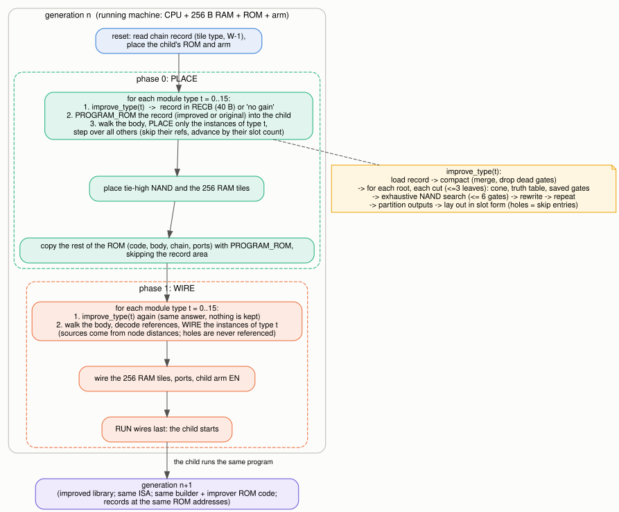

* **HD (hardware description).** Library modules (`not and or xor mux ha fa`, plus the RAM word tile) and a body that instantiates them with node-distance references; a chain section (5-byte tile rules) generates the 256 RAM word tiles by loops; ports. Records have fixed extent `4 + 3·slots + n_out`; an improved record uses *slot form*: removed gates become holes (skip entries), so the improved record still fits the old record's space and is read by the builder from a RAM buffer exactly like from ROM.
* **Builder.** Two phases (0 = place, 1 = wire) × 16 per-type groups. At the start of each group `improve_type(t)` runs on type t (twice per generation, once per phase; the second call finds nothing new). `progrec` PROGRAM_ROMs the improved records into the child before any wire; the bulk ROM copy skips the record area.
* **Improver** (normative model `ref_improve.py`): stable compaction (merge identical gates, drop dead gates) → for each root, cuts of ≤ 3 leaves → truth tables → exhaustive iterative-deepening NAND search (up to 6 new gates) → rewrite → partition (outputs last, ascending) → layout (slot form, size check) → accept only on strict gain; record limit 40 B.
* **RAM.** One 256 B array. Builder and improver temporaries *overlay* (never live together); only a 29 B persistent block crosses calls; the 40 B improved-record buffer doubles as the improver's scratch.

## 4. Results

### 4.1 Hardware before / after

| module | gates g1 | gates g2 | improver instructions (that module) |
|---|---:|---:|---:|
| not | 1 | 1 | 2,111 |
| and | 2 | 2 | 7,346 |
| or | 3 | 3 | 19,146 |
| xor | 9 | 4 | 408,076 |
| mux | 8 | 4 | 85,983 |
| ha | 11 | 5 | 393,983 |
| fa | 25 | 9 | 2,757,238 |

(The audit-only modules, which are not in the seed library: xnor 10→5, maj 12→6, and3 4→4 — already minimal; see `data/tab_permodule.md`.)

Whole machine: g1 15,495 NAND + 2,104 DFF (17,601 parts, 33,119 wires, 13,221 programmed ROM bytes) → g2 = g3 14,549 NAND + 2,104 DFF (16,655 parts, 31,227 wires, 13,176 ROM bytes). Weighted cost NAND + 6·DFF: 28,119 → 27,173 (−3.4 %). The 946 NAND are −6.1 % of NAND and −29 % of the logic outside the RAM array. ROM bits are not in this cost; at the HANDOFF's factor f × 12.3 per bit the 16 KiB ROM dominates for any f ≳ 0.1 and the saving shrinks accordingly (an estimate, not measured).

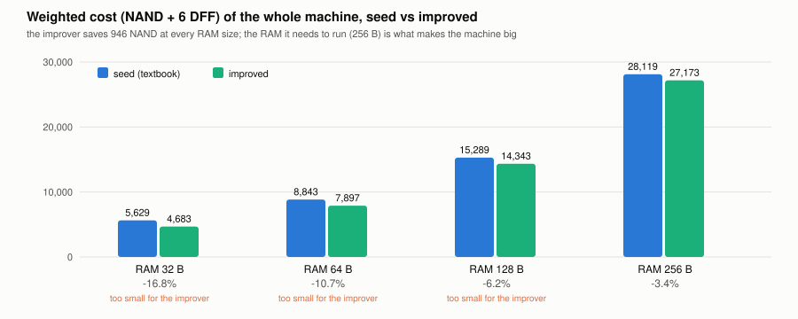

**Gate-level pictures** (Graphviz; seed left, improved right):

| xor | mux |
|---|---|
| 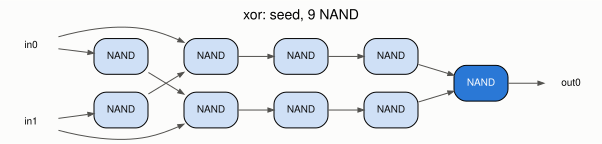 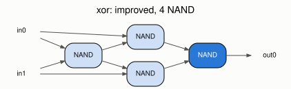 | 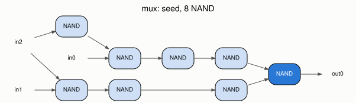 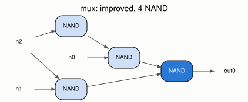 |

| half adder | full adder |
|---|---|
| 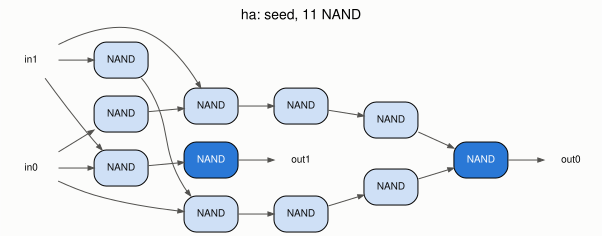 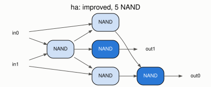 | 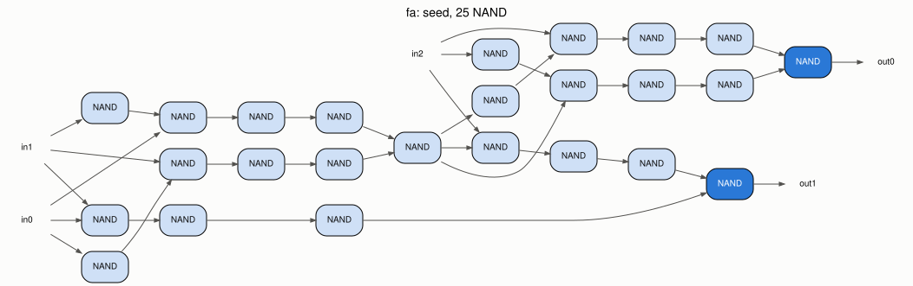 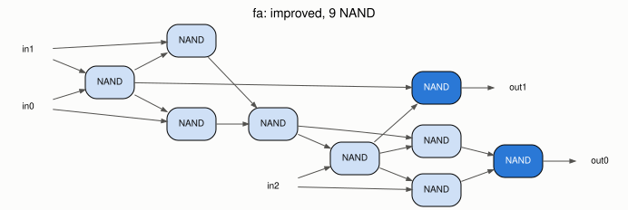 |

The improver finds the textbook 4-NAND xor, shares the inverted select of the mux, and the 9-NAND full adder (two 4-NAND xors plus one shared NAND) — none of these are stored in ROM (audit B).

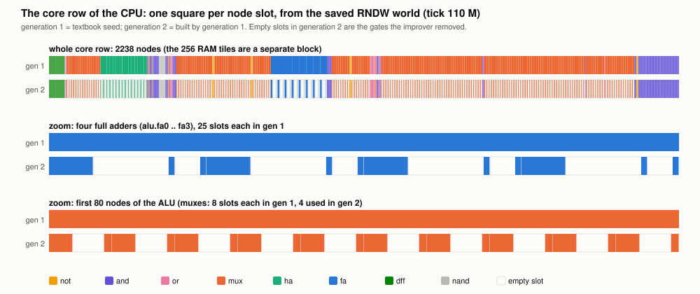

RNDW's own renderer, small windows (the full-chip views are not informative; wires in wide windows are drawn as fans): `svgs/improver_gen1_alu_fa0_window.svg` vs `svgs/improver_gen2_alu_fa0_window.svg` (first full adder of the ALU, 25 vs 9 gates) and `svgs/improver_gen1_corner_arm_rom_ram.svg` (arm, ROM and the first RAM tiles).

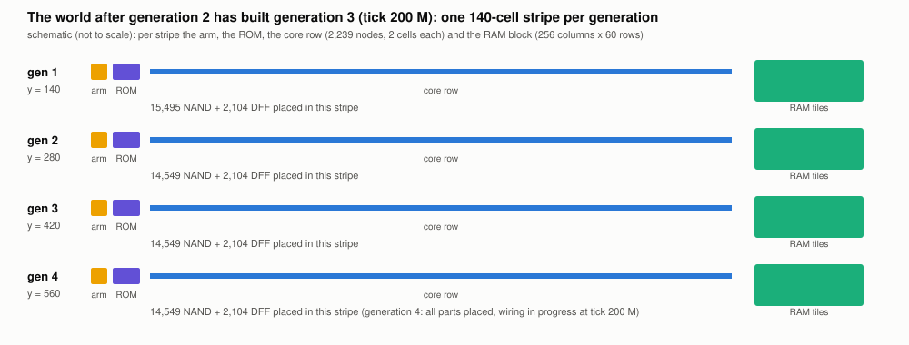

Generation n lives in the stripe whose arm origin is (0, 140·n); the figure shows the state at tick 200 M: g1–g3 complete, g4 fully placed and about two thirds wired.

## 5. Where the bytes are

### 5.1 ROM (16,350 B)

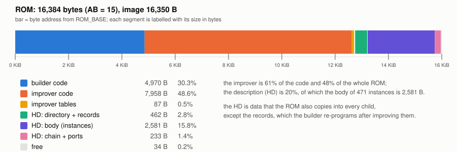

| region | address | bytes | content |
|---|---|---:|---|
| builder code | 0x0000–0x136A | 4,970 | reset, group loop, rdb/add16/put5, lookup, decref, resolve, emit, gates, skiprefs, progrec |
| improver code | 0x136A–0x3280 | 7,958 | load, compact, nextcut, cone, search, rewrite, partition, layout, improve_type |
| improver tables | 0x3280–0x32E0 | 96 | bit masks, function tables, module-type maps (each line tagged) |
| HD header, directory | 0x32E0–0x3320 | 64 | |
| module records | 0x3320–0x34CE | 430 (+18 B record-area padding up to the body) | not and or xor mux ha fa and the RAM word tile (the only region the improver changes) |
| body | 0x34E0–0x3EF5 | 2,581 | the core netlist as instances |
| chain + ports | 0x3EF5–0x3FDE | 233 | RAM tile rules, ports |
| free | | 34 | **no room left at AB = 15** |

Every byte has a listing line with a comment (`trace_check.py`). Per-routine tables below (size, and dynamic instruction count for g1→g2 and g2→g3):

**Builder**

| builder routine | bytes | what it does | instructions gen 1->2 | gen 2->3 |
|---|---:|---|---:|---:|
| `start` | 416 | reset code: init, chain record, place ROM + arm | 0.00 M | 0.00 M |
| `group` | 562 | phase/group loop and the instance walk (incl. skip) | 0.70 M | 0.70 M |
| `phase_done` | 160 | tie node, start of the RAM tile code | 0.00 M | 0.00 M |
| `tile_loop` | 220 | RAM tile loop | 0.06 M | 0.06 M |
| `tiles_done` | 80 | end of tiles, phase switch | 0.00 M | 0.00 M |
| `rom_loop` | 158 | bulk ROM copy (skips the record area) | 0.70 M | 0.70 M |
| `pass2_tail` | 352 | ports, EN and RUN wires, halt | 0.00 M | 0.00 M |
| `rdb` | 40 | read one ROM/RAM byte through a pointer | 3.82 M | 3.82 M |
| `add16` | 100 | 16-bit add with carry test | 5.11 M | 5.11 M |
| `put5` | 44 | copy a 5-byte source | 2.64 M | 2.64 M |
| `skiprefs` | 112 | step over references (no decoding) | 0.80 M | 0.80 M |
| `progrec` | 264 | PROGRAM_ROM one record | 0.01 M | 0.02 M |
| `lookup` | 172 | directory -> record header | 0.81 M | 0.81 M |
| `decref` | 698 | decode one reference to a pin position | 0.64 M | 0.64 M |
| `resolve` | 984 | signal -> source pin (core and tile rules) | 2.26 M | 2.26 M |
| `emit` | 356 | one PLACE or the WIRE commands of one gate | 3.60 M | 3.60 M |
| `gates` | 252 | walk the gate entries of a record (incl. skip entries) | 3.17 M | 3.17 M |
| **builder total** | **4,970** | | **24.32 M** | **24.32 M** |

**Improver**

| improver routine | bytes | what it does | instructions gen 1->2 | gen 2->3 |
|---|---:|---|---:|---:|
| `irdb` | 34 | read a byte (improver copy of rdb) | 0.01 M | 0.00 M |
| `bt` | 48 | test / set / clear bit in a 40-bit set | 0.65 M | 0.07 M |
| `bs` | 54 | bit-set helpers | 0.07 M | 0.01 M |
| `keycmp` | 74 | compare two gates (merge, sort) | 0.12 M | 0.02 M |
| `ins` | 184 | insert a gate | 0.28 M | 0.06 M |
| `load` | 848 | read a record into the gate arrays | 0.02 M | 0.01 M |
| `compact` | 1062 | merge identical gates, drop dead gates and holes | 0.33 M | 0.03 M |
| `nextcut` | 410 | enumerate the next cut of a root | 0.26 M | 0.05 M |
| `cone` | 1270 | cone, saved-gate count, truth tables | 1.18 M | 0.15 M |
| `search` | 598 | exhaustive iterative-deepening NAND search | 4.33 M | 0.84 M |
| `rewrite` | 786 | insert the new gates, rewire the users | 0.03 M | 0.00 M |
| `partition` | 900 | move outputs to the end, ascending | 0.00 M | 0.00 M |
| `layout` | 1208 | slot form: holes as skip entries, size check | 0.02 M | 0.00 M |
| `improve_type` | 482 | driver of the loop | 0.05 M | 0.01 M |
| **improver total** | **7,958** | | **7.35 M** | **1.26 M** |

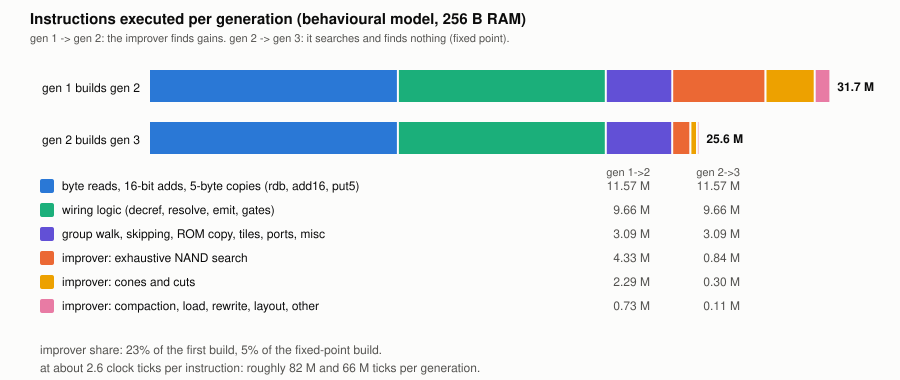

Reading the tables:

* The improver is 60 % of the code, but only 23 % of the dynamic instructions in g1→g2 (7.35 M of 31.67 M). The search alone is 4.3 M instructions; the full adder takes 2.76 M of the 4.05 M spent on the library modules.
* The builder is the same program in both generations: 24.32 M instructions (the child's 25.58 M total = builder 24.32 M + improver 1.26 M). Most time goes to the generic reference machinery (`add16`, `rdb`, `emit`, `gates`, `put5`), not to anything specific to improvement.
* In g2→g3 the improver still *looks* at every module (1.26 M instructions) and finds nothing: that is the fixed-point check, and it is the cost of verifying "no further improvement exists within this search".

### 5.2 RAM (256 B)

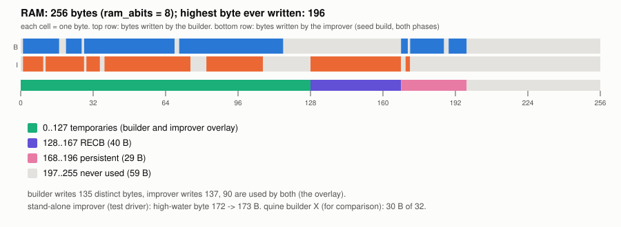

| addresses | bytes | use |
|---|---:|---|
| 0–127 | 128 | temporaries; builder variables and improver variables overlay (builder ~110 B touched, improver ~100 B) |
| 128–167 | 40 | RECB: improved record = improver scratch (cone tables, search tables, gate arrays are inside it or the overlay) |
| 168–196 | 29 | persistent block (mode, type, record pointer, tile parameters, RUN sink coordinates…) |
| 197–255 | 59 | unused — high-water mark 196 |

Measured by instrumenting the model with RAM pre-filled with 1s, as built RAM powers up. The 59 free bytes are the slack the user accepted at M6 (power-of-two RAM, improver state left as is). X's builder used 30 B of 32. In Y the builder's temporaries reach address 115 and its persistent block ends at 196; the improver's temporaries (to 106) overlay them, so its marginal RAM cost is mostly the 40 B record buffer RECB plus a few persistent bytes (estimate from the touched-address lists in `data/measure.json`, not a separate build). The 256 B size itself comes from the machine being built (256 B of RAM is 2,048 of its 2,104 DFF), not from the program.

## 6. Quine vs improver

### 6.1 What differs

| aspect | quine (X) | self-improver (Y) |
|---|---|---|
| description | flat node list (Exp-Golomb back references), CPU 1,658 B | hierarchical modules + body + chain; 3,326 B |
| ROM check | child ROM byte-identical to parent | records change; rest identical |
| code | ~2.2 KB generator | 4,970 B builder + 7,958 B improver |
| ISA | AB 13 (4 KiB ROM) | AB 15 (16 KiB ROM; 2 more address bits cost +50 NAND, +4 DFF in the CPU) |
| coordinates | arm-relative | arm-relative |
| fixed point | after 1 generation | after 2 (g2 = g3) |

### 6.2 What the improver adds to the builder

Roughly 1.6× the builder's code, about 40 B of extra RAM (the record buffer; estimate), and a ROM that grew from 4 KiB to 16 KiB — three bits more of address, which is cheap in hardware but is exactly the "ROM dominates cost" caveat above. For the 946 NAND saved the improver is repaid within the first generation only if ROM bits are free (f ≈ 0); at f = 0.01 (X's lowest figure) 7,958 B × 8 × 0.123 ≈ 7.8 k weighted units against a saving of 946 — **not** a net win in a cost model that charges for the ROM that holds the improver. I report this because the question is a lower bound: the improver is an *existence* of a self-improving design, not a cost-effective one.

### 6.3 Time (estimated)

Instructions are measured (31.67 M for g1→g2, 25.58 M for g2→g3 in the model). Ticks are *estimated* at 2.6 ticks/instruction (demo program on the gate-level netlist: 131 instructions in 336 ticks): ≈ 82 M and ≈ 66 M ticks. The RNDW run is consistent with that (g3 complete before tick 200 M). X's 7.65 M ticks for a machine with about 6× fewer parts is in the same range per part. Simulator wall time was roughly 7 h in all (2.7 h for the first 110 M ticks, 4 h for the next 90 M, with one run lost to a session restart and resumed from its saved state).

## 7. Verification

* **RNDW end to end** (`tests/run_y_world.py`, `verify_y_world.py`, log `tests/m6_world_log.txt`): three generations, 0 faults, equal to `ref_flatten` output for the improved and unimproved libraries.
* **Audit A** the seed library is textbook; **B** none of the improved gate lists appears in the seed ROM — the answers are computed; **C** the improver is general (xnor 10→5, maj 12→6, and3 stays 4; the assembly builder+improver builds the reference improved child: 22,174 commands, 21.4 M instructions).
* **ISA at AB = 15** (`HACK_VN_AB.md`): the M1 core-decode test (`coretest.py`) was originally run at AB = 13/14 only; it was rerun at AB = 15 after the first delivery of this write-up: exhaustive decode check of all 131,072 (state, address) cases, boundary program, K1–K4 (tick counts equal to X's) and 20 fuzz images (73,443 instructions) all ok.
* **Behaviour**: the improved 256 B machine runs the demo (131 instructions, 336 ticks, identical to the seed) and 30 random programs in lockstep with the ISA model: 30/30.
* **Mutation**: 60 single-bit changes in executed instruction words (builder and improver; 5,916 distinct executed words): 60/60 killed. Caveats: "killed" counts any change in the arm write order, slightly stricter than set equality; dead code cannot be tested this way; 60 is a sample.
* **Bugs found on the way** that tests caught: W = 256 and the signed 8-bit compare of tile indices ≥ 128 (found in M5, fixed there; the RNDW run exercises tiles 128–255); a chain count off by one (hd2asm); PICKHI divisor ≤ 64 assertion.

## 8. What it means for the lower-bound question (and what it does not)

1. **Upper bound only.** A self-replicating machine that also reduces its own logic exists at 256 B RAM and 16 KiB ROM in this world. Nothing shows these are minimal. The X point is far smaller (32 B / 3.9 KB) for replication alone.
2. **Where the design hides** (HANDOFF list): the *specification* of the improvement (the module ladder and the NAND cost function are mine); DFF and the arm as primitives; the RAM array, which is 2,048 of 2,104 DFF and which the improver does not touch; the HD format and the textbook seed (the seed *contains* the redundancy the improver removes — a seed already at the optimum improves nothing); the search depth GMAX = 6 (it is why `fa` stops at 9 gates; with 25 gates the optimum for the NAND-only fa is 9 and reached).
3. **Self-improvement is weak here.** The loop reaches a fixed point after one step, because the improver is not in the improvable set. A stronger definition (HANDOFF §5) would let the improved machine contain a better improver; that needs an ISA with room (the ROM is 34 B from full) and a way to measure the improver's own cost, and is not attempted.
4. **ROM dominates.** In bits, the ROM is 131 kbit against 17.6 k parts; any cost model that counts ROM makes the improver a net loss at this size (§6.2).

## 9. Reproduce

Layout assumed (as in the `nandgen_workspace.tar.gz` / the Project): `nandgen/y/` (everything for Y) and `nandgen/rndw/` (the Rust simulator). Needs Python 3 (standard library only) and a Rust toolchain; nothing else. No absolute paths are used any more; the simulator is found at `nandgen/rndw/target/release/rndw` or via `$RNDW`.

```
(cd nandgen/rndw && cargo build --release --offline)                    # the simulator, no dependencies
cd nandgen/y
python3 tests/test_m5.py && python3 tests/test_m5_improver.py          # model: builder and improver
python3 tests/test_m6_audit.py && python3 tests/test_m6_behaviour.py    # audits, behaviour
python3 tests/run_y_world.py hd/core_r8.hd 200000000 OUT                # RNDW run (~7 h; try 300000 first: ~20 s, only checks the build starts)
python3 tests/verify_y_world.py OUT/final.txt 1:hd/core_r8.hd:OUT/seed.bin 2:hd/core_r8_improved.hd:OUT/child.bin
python3 writeup/collect.py && python3 writeup/figs.py                   # measurements and figures (figs.py reads writeup/states/*.txt, or $STATE_G2 / $STATE_G3)
```
`run_y_world.py` checkpoints: it cuts the run into segments of `$CHUNK` ticks (default 10,000,000), each saved as `OUT/ckpt_<ticks>.txt` (only the newest is kept; the last becomes `OUT/final.txt`). If a run dies, rerun the same command with `RESUME=1` (same `OUT`) and it continues from the newest checkpoint; chunked, straight and resumed runs give byte-identical states (checked on short runs). Added 2026-10-15; the 200 M tick runs of M6 were made before this and without it.
Files `run_y_world.py` needs (tested: a tree containing exactly these plus the built `rndw` runs): `tests/{run_y_world,run_builder,machine_lockstep}.py`, `tools/{hd,hd2asm,ref_flatten,ref_improve,asm,script_world}.py`, `isa/{common,isahack,fastsim,nandgen}.py`, `isa/nl_*.py`, `src/{macros,ram,builder,improver}.asm`, `hd/core_r8.hd`. (`script_world.py` was vendored from X's `isa/` on 2026-10-15; before that the script imported it from a hard-coded path outside the tree.) `OUT/child.hd` (the improved description the ROM should build) is byte-identical to the committed `hd/core_r8_improved.hd` (checked).
Restart points: `states/README.md` (a state resumes with `rndw --world FILE --steps N --save OUT`; `SHA256SUMS` lists hashes).

## 10. File index

* `HACK_VN_AB.md` — the Hack-vN-AB ISA as used by Y (memory map, AP, timing, size, verification).
* `M7_WRITEUP.md` (this), `M7_WRITEUP.html` (same with figures inline).
* `figs/` — rom map, ram map, instruction profile, cost chart, core row g1 vs g2, world stripes, flow, and Graphviz gate graphs for xor/mux/ha/fa seed vs improved.
* `svgs/` — RNDW renderer windows (ALU full-adder g1 vs g2; arm/ROM/RAM corner).
* `states/` — saved worlds: quine g1, g2 built, g2 running, g3 built, g4 started; improver g1 start, g2 start, g2 built (tick 110 M), g3 built (tick 200 M); the two ROM images and the seed scripts. Large (not stored in the Project).
* `data/` — measurements (`measure.json`, `routines.json`, `modules.json`, `improver_per_module.json`) and the tables above.
* `collect.py`, `figs.py` — scripts that produce them.

## 11. Next steps (suggestions)

* Put the improver's own gates into the improvable set (it is software here; the fixed point would then be about the ROM's description, not about the hardware).
* Count ROM bits in the weighted cost and decide whether to report Y with or without it as the headline.
* Measure ticks per generation directly (a counter around the builder in the model, or a shorter RNDW run with markers).
* A seed that is *not* textbook (partly optimised) to see where the improver stops paying.
